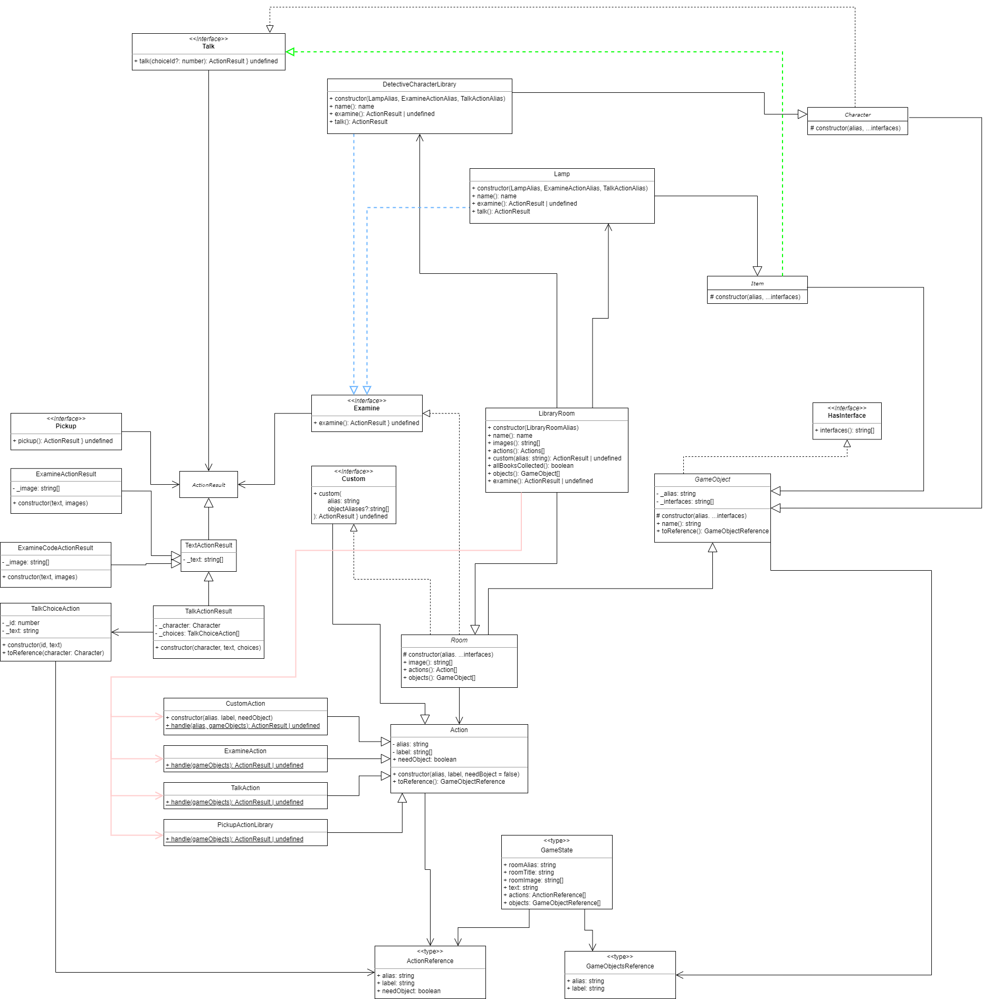

# Expert review (Sprint 2)

> ## Gekozen learning stories voor deze sprint
> - [#13 Als student wil ik leren hoe ik abstracte classes toepas in mijn code](https://gitlab.fdmci.hva.nl/propedeuse-hbo-ict/onderwijs/2023-2024/out-d-se-gd/blok-3/jooduumeenii48/-/issues/13)
> - [#15 Als student wil ik leren hoe ik interfaces toepas in mijn code](https://gitlab.fdmci.hva.nl/propedeuse-hbo-ict/onderwijs/2023-2024/out-d-se-gd/blok-3/jooduumeenii48/-/issues/15)
> - [#16 Als student wil ik leren wat generics zijn en hoe ik ze gebruik in mijn code](https://gitlab.fdmci.hva.nl/propedeuse-hbo-ict/onderwijs/2023-2024/out-d-se-gd/blok-3/jooduumeenii48/-/issues/16)

> ## Abstract class (Deze sprint)
> Een ``abstracte klasse`` is als een blauwdruk voor andere klassen. Je kunt er geen objecten rechtstreeks van maken, maar het definieert gemeenschappelijke eigenschappen en acties die andere klassen kunnen overnemen.
>
> ```typescript
> /**
>  * Base class used to represent a character
>  *
>  * @remarks Imp*-lements the Talk action by default
>  */
> export abstract class Character extends GameObject implements Talk {
>     /**
>      * Create a new instance of this character
>      *
>      * @param alias Alias of this character
>      * @param interfaces List of interfaces this character implements
>      */
>     protected constructor(alias: string, ...interfaces: string[]) {
>         super(alias, ...interfaces, TalkActionAlias);
>     }
> 
>     /**
>      * Handles the talk action on the character
>      * @param _choiceId The choice ID representing the player's selection
>      * @returns An action result for talking to the character
>      */
>     public abstract talk(choiceId?: number): ActionResult | undefined;
> }
> ```
> ### Toelichting 
> In dit voorbeeld helpt de Character-klasse ons om personages in een spel te maken bij mij is het de DetectiveCharacterLibrary-klasse. Het zegt dat elk personage de mogelijkheid moet hebben om te praten. Maar het zegt niet hoe elk personage moet praten, dat wordt later bepaald door de DetectiveCharacterLibrary-klasse die van deze abstracte klasse erft.
>
> ### Bronnen 
> [typescript Abstract class](https://www.typescriptlang.org/docs/handbook/2/classes.html#abstract-classes-and-members)


> ## Interface (Deze sprint)
> Een ``interface`` is als een contract waarin staat wat een object moet kunnen doen. Het vertelt andere delen van de code welke acties beschikbaar zijn, maar het geeft geen details over hoe die acties worden uitgevoerd.
>
> ```typescript
> /**
>  * Interface for GameObjects that need to support the Examine action
>  */
> export interface Examine {
>     /**
>      * Execute the Examine action
>      * 
>      * @returns Result of the Examine action
>      */
>     examine(): ActionResult | undefined;
> }
> 
> ```
> ### Toelichting 
> De Examine-interface definieert dat objecten de mogelijkheid moeten hebben om te worden onderzocht. Het zegt niet hoe elk object moet worden onderzocht, maar het zorgt ervoor dat alle klasse's die deze interface implementeren, een examine-methode hebben om dat te doen.
>
> ### Bronnen 
> [knowledgebase Interface](https://knowledgebase.hbo-ict-hva.nl/1_beroepstaken/software/ontwerpen/oop/oop_concepten/oop_interface/)


> ## Generics (Deze sprint)
> Generics bieden een flexibele benadering om met verschillende datatypes te werken. Ze stellen je in staat om dynamische types te gebruiken, waardoor je functies of klassen kunt maken die met verschillende soorten data kunnen omgaan, zonder dat je het specifieke type vooraf hoeft te bepalen.
>
> ```typescript
> /**
>  * Cast the given instance of a class to T
>  *
>  * @param instance Instance of a class to cast
>  *
>  * @returns Casted instance
>  */
> export function castTo<T>(instance: unknown): T {
>     return instance as T;
> }
> ```
> ### Toelichting 
> Generics bieden een flexibele manier om met verschillende datatypes te werken zonder specifieke typen vooraf te bepalen. De castTo-functie in deze code maakt gebruik van generics om een gegeven instantie van een klasse naar een specifiek type T om te zetten. Hierdoor kunnen functies of klassen worden gemaakt die dynamisch met verschillende soorten data kunnen omgaan.
>
> ### Bronnen 
> [knowledgebase Generic](https://knowledgebase.hbo-ict-hva.nl/1_beroepstaken/software/ontwerpen/oop/oop_concepten/oop_generic/)

> ## UML class diagram
> 

> ## Gekozen learning stories vorige expert
> - [#11 Als student wil ik leren hoe ik de OO-principes abstraction, encapsulation en inheritance toepas in mijn code](https://gitlab.fdmci.hva.nl/propedeuse-hbo-ict/onderwijs/2023-2024/out-d-se-gd/blok-3/jooduumeenii48/-/issues/11)
> - [#12 Als student wil  ik leren hoe ik het OO-principe polymorfisme toepas in mijn code](https://gitlab.fdmci.hva.nl/propedeuse-hbo-ict/onderwijs/2023-2024/out-d-se-gd/blok-3/jooduumeenii48/-/issues/12)
> - [#14 Als student wil ik leren hoe ik static functies en variabelen gebruik in mijn code](https://gitlab.fdmci.hva.nl/propedeuse-hbo-ict/onderwijs/2023-2024/out-d-se-gd/blok-3/jooduumeenii48/-/issues/14)

> ## Abstarction (Vorige sprint)
> In objectgeoriënteerd programmeren is ``abstractie`` het idee om alleen de belangrijkste dingen van een object te laten zien en de complexe details te verbergen. Het is het maken van een simpele samenvatting van iets moeilijk te begrijpen is, zodat je alleen op het belangrijkste kunt concentreren. Abstractie maakt moeilijke dingen begrijpelijk door alleen te kijken naar wat echt belangrijk is.
> 
> ```typescript 
> /**
>  * Handelt een klikgebeurtenis op de "OK" knop voor de minigame af
>  */
> private handleClickCodeOK(): void {
> 
>     // Controleert of de ingevoerde code overeenkomt met de geheime code
>     if (this.codeSoFar === "4422") {
> 
>         console.log("Stuur ontgrendelingscode-actie naar API met code: " + this.codeSoFar);
> 
>         // Stelt isCodeCorrect in op true als de code correct is
>         this.isCodeCorrect = true;
> 
>     } else {
> 
>         console.log("Onjuiste code ingevoerd, probeer opnieuw.");
> 
>         // Stelt isCodeCorrect in op false als de code onjuist is
>         this.isCodeCorrect = false;
> 
>     }
> 
>     // Reset de ingevoerde code
>     this.codeSoFar = "";
> 
>     // Vraagt een update aan om de UI bij te werken
>     this.requestUpdate();
> }
> ```
> ### Toelichting 
> In dit voorbeeld zie je in de handleClickCodeOK() functie de logica voor het controleren van de ingevoerde code en het bijwerken van de UI. Het verbergt de details van hoe de code wordt gecontroleerd en wat er gebeurt als de code correct of incorrect is, waardoor het gemakkelijker wordt om alleen te focussen op wat er moet gebeuren wanneer de "OK" knop wordt geklikt.
>
> ### Bronnen 
> [knowledgebase Abstraction](https://knowledgebase.hbo-ict-hva.nl/1_beroepstaken/software/ontwerpen/oop/pijlers_van_oop/abstraction/)


> ## Encapsulation (Vorige sprint)
> In objectgeoriënteerd programmeren biedt ``Encapsulation`` kunnen we bepaalde informatie en functies in een klasse verbergen voor de buitenwereld, zodat alleen de klasse er zelf toegang toe heeft. Dit helpt om onze code veiliger te maken en om te voorkomen dat externe code per ongeluk de interne werking van onze klasse verstoort.
> 
> ```typescript 
> export class GameCanvas extends LitElement {
>     private codeSoFar: string = ""; // De cijfers die door de speler zijn ingevoerd
>     private isCodeCorrect: boolean = false; // of de ingevoerde code correct is of niet
>     private secretCode: string = "5"; // De juiste code om het tweede nummer van de geheime kamer te ontgrendelen
> 
>     /**
>      * Wanneer er op een nummerknop wordt geklikt, wordt dat nummer toegevoegd aan de ingevoerde code
>      */
>     private handleClickCode(code: string): void {
>         this.codeSoFar += code;
>         this.requestUpdate(); // Het scherm updaten om de nieuwe code te tonen
>     }
> 
>     /**
>      * Behandelt een klikgebeurtenis op de "OK" knop voor de minigame
>      */
>     private handleClickCodeOK(): void {
> 
>         // Controleert of de ingevoerde code overeenkomt met de geheime code
>         if (this.codeSoFar === "4422") {
> 
>             console.log("Stuur ontgrendelingscode-actie naar API met code: " + this.codeSoFar);
> 
>             // Stelt isCodeCorrect in op true als de code correct is
>             this.isCodeCorrect = true;
> 
>         } else {
> 
>             console.log("Onjuiste code ingevoerd, probeer opnieuw.");
> 
>             // Stelt isCodeCorrect in op false als de code onjuist is
>             this.isCodeCorrect = false;
> 
>         }
> 
>         // Reset de ingevoerde code
>         this.codeSoFar = "";
> 
>         // Vraagt een update aan om de UI bij te werken
>         this.requestUpdate();
> 
>     }
> 
> 
>     /**
>      * Controleert of de ontgrendelingscode-minigame is ingeschakeld
>      */
>     private get unlockCodeMiniGameEnabled(): boolean {
> 
>         // Geeft true terug als de minigame "unlock-code" is
>         return this.miniGame === "unlock-code";
> 
>     }
> 
>     /**
>      * Handelt de backspace-knop voor de minigame af
>      */
>     private handleBackspace(): void {
> 
>         // Verwijdert het laatste karakter uit de ingevoerde code
>         this.codeSoFar = this.codeSoFar.slice(0, -1);
> 
>         // Vraagt een update aan om de weergegeven code bij te werken
>         this.requestUpdate();
>     }
> }
> ```
> ### Toelichting 
> In dit voorden worden bepaalde variabelen en functies gemarkeerd als privé, wat betekent dat alleen de GameCanvas-klasse zelf ze kan gebruiken. Deze privévariabelen en -functies houden interne gegevens bij en voeren taken uit binnen de klasse, terwijl ze tegelijkertijd beschermen tegen directe toegang van buitenaf. Dit helpt om de code georganiseerd en veilig te houden.
>
> # Bronnen 
> [knowledgebase Encapsulation](https://knowledgebase.hbo-ict-hva.nl/1_beroepstaken/software/ontwerpen/oop/pijlers_van_oop/encapsulation/#inkapseling-encapsulation)


> ## Inheritence (Vorige sprint)
> In objectgeoriënteerd programmeren biedt ``inheritance`` een manier waarmee een klasse alle eigenschappen en methoden van een hoofd klasse kan overnemen. Dit bevordert codehergebruik door een nieuwe klasse te laten profiteren van de functionaliteit van een bestaande klasse.
> 
> ```typescript
> /**
>  * Exporteren van het alias van de BookOne klasse
>  */
> export const BookOneAlias: string = "book-1-item";
> 
> /**
>  * Klasse die BookOne vertegenwoordigt
>  */ 
> export class BookOne extends Item implements Examine, Pickup, Talk {
> 
>     /**
>      * Constructor voor de BookOne klasse
>      */
>     public constructor() {
> 
>         // Roep de constructor van de superklasse (Item) aan met de alias voor BookOne, en de acties examine, pickup en talk
>         super(BookOneAlias, ExamineActionAlias, PickupActionAlias, TalkActionAlias);
> 
>     }
> 
>     // Andere methoden specifiek voor de BookOne klasse...
> }
> ```
> ### Uitleg 
> In dit voorbeeld wordt inheritance gebruikt, waarbij Item de hoofdklasse (superklasse) vertegenwoordigt en BookOne de subklasse is die ervan erft. De BookOne-klasse erft alle basisfuncties en eigenschappen van de hoofdklasse (Item), maar voegt ook specifieke acties toe, zoals onderzoeken, oppakken en praten, die uniek zijn voor dit boekobject. Dit helpt om de code georganiseerd te houden en bevordert het hergebruik van code.
>
> ### Bronnen
> [knowledgebase Inheritence](https://knowledgebase.hbo-ict-hva.nl/1_beroepstaken/software/ontwerpen/oop/pijlers_van_oop/inheritance/)


> ## Polymorfisme (Vorige sprint)
> ``Polymorfisme`` betekent dat je verschillende dingen kunt doen met objecten van verschillende klassen, zelfs als ze dezelfde naam hebben voor een bepaalde actie, zoals een methode. Dus zelfs als twee klassen dezelfde methode hebben, kunnen ze die methode anders uitvoeren, afhankelijk van hoe ze zijn gedefinieerd. Dit maakt het gemakkelijk om op een consistente manier met verschillende soorten objecten te werken, zelfs als ze verschillende gedrag hebben.
>
> ```typescript 
> import { ActionResult } from "../base/actionResults/ActionResult";
> import { TextActionResult } from "../base/actionResults/TextActionResult";
> import { Examine, ExamineActionAlias } from "../base/actions/ExamineAction";
> import { Talk, TalkActionAlias } from "../base/actions/TalkAction";
> import { Item } from "../base/gameObjects/Item";
> 
> /** 
>  * Alias voor de BookCase klasse
>  */
> export const BookCaseAlias: string = "book-case";
> 
> /** 
>  * Variabele om bij te houden of de boekenkast is onderzocht
>  */
> export let examined: boolean = false;
> 
> /** 
>  * Klasse die de boekenkast vertegenwoordigt en implementeert Examine en Talk interfaces
>  */
> export class BookCase extends Item implements Examine, Talk {
> 
>     /**
>      * Constructor voor de BookCase klasse
>      */
>     public constructor() {
>         // Roep de constructor van de superklasse (Item) aan met de boekenkast alias, Examine en Talk action aliases
>         super(BookCaseAlias, ExamineActionAlias, TalkActionAlias);
>     }
> 
>     /**
>      * Methode die het onderzoeken van de boekenkast afhandelt
>      * @returns Een ActionResult voor het onderzoeken van de boekenkast
>      */
>     public examine(): ActionResult | undefined {
>         if (examined) {
>             // Als onderzocht, retourneer een TextActionResult die aangeeft dat de boekenkast al is onderzocht
>             return new TextActionResult(["Je hebt de boekenkast al onderzocht en je hebt al dezelfde boeken op de planken gevonden."]);
>         } else {
>             // Werk de onderzochte status bij naar true
>             examined = true;
>             // Als niet onderzocht, retourneer een TextActionResult die de boeken op de planken beschrijft
>             return new TextActionResult(["Je hebt de boekenkast onderzocht en zag verschillende vergelijkbare boeken met nummers op de planken."]);
>         }
>     }
> 
>     /**
>      * Methode die de praatactie op de boekenkast afhandelt
>      * @param _choiceId De keuze-ID die de selectie van de speler vertegenwoordigt
>      * @returns Een ActionResult voor het praten met de boekenkast
>      */
>     public talk(_choiceId?: number | undefined): ActionResult | undefined {
>         return new TextActionResult(["Je kunt niet met een boekenkast praten."]);
>     }
> 
> } 
> ```
>
> ### Uitleg
> In dit voorbeeld wordt polymorfisme gebruikt in de BookCase-klasse. Hoewel de boekenkast en andere objecten verschillende acties kunnen uitvoeren, zoals onderzoeken of praten, kunnen ze nog steeds op dezelfde manier worden behandeld. Dit betekent dat we dezelfde methode examine() en talk() kunnen gebruiken voor de boekenkast, zelfs als het gedrag anders is dan bij andere objecten. Hierdoor kunnen we efficiënter en flexibeler code schrijven.
>
> ### Bronnen
> [knowledgebase Polymorfisme](https://knowledgebase.hbo-ict-hva.nl/1_beroepstaken/software/ontwerpen/oop/pijlers_van_oop/polymorfisme/)


> ## Static functies (Vorige sprint)
> Een ``statis function`` is een functie die aan de klasse zelf is gekoppeld, in plaats van aan een specifiek object (instantie) van die klasse. Dit betekent dat je de functie kunt aanroepen zonder een instantie van de klasse te maken. Een statische functie wordt vaak gebruikt voor taken die gerelateerd zijn aan de klasse als geheel
>
> ```typescript
> import { ActionResult } from "../base/actionResults/ActionResult";
> import { Action } from "../base/actions/Action";
> import { GameObject } from "../base/gameObjects/GameObject";
> import { castTo, implementsInterface } from "../base/helpers";
> 
> /** Alias voor de PickupAction klasse */
> export const PickupActionAlias: string = "pickup-action";
> 
> /** Interface die aangeeft dat een object kan worden opgepakt */
> export interface Pickup {
>     pickup(): ActionResult | undefined;
> }
> 
> /** Klasse die de Pickup-actie vertegenwoordigt */
> export class PickupAction extends Action {
>     public constructor() {
>         super(PickupActionAlias, "Pickup", true);
>     }
> 
>     /**
>      * Methode die de Pickup-actie afhandelt voor een game object
>      * @param gameObject Het game object waarop de actie wordt uitgevoerd
>      * @returns Een ActionResult voor het uitvoeren van de Pickup-actie op het gegeven game object
>      */
>     public static handle(gameObject: GameObject): ActionResult | undefined {
>         if (implementsInterface(gameObject, PickupActionAlias)) {
>             return castTo<Pickup>(gameObject).pickup();
>         }
> 
>         return undefined;
>     }
> }
> ```
>
> ### Uitleg
> In deze voorbeeld wordt een static functie gebruikt voor de "Pickup" actie die ik heb gemaakt. Het handelt de "Pickup" actie af voor een game object. Het kijkt eerst of het gekozen game object de mogelijkheid heeft om opgepakt te worden. Als dat zo is, wordt de "pickup" actie van het game object uitgevoerd. Zo niet, dan gebeurt er niets.
>
> ### Bronnen
> [knowledgebase static functies](https://knowledgebase.hbo-ict-hva.nl/1_beroepstaken/software/ontwerpen/oop/oop_concepten/oop_static/)