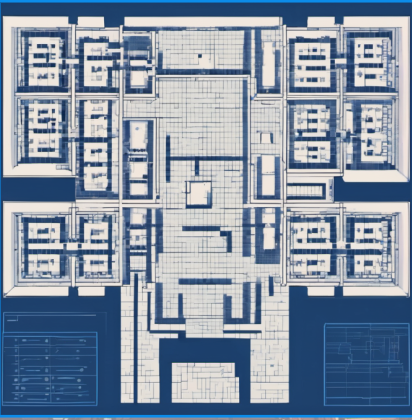
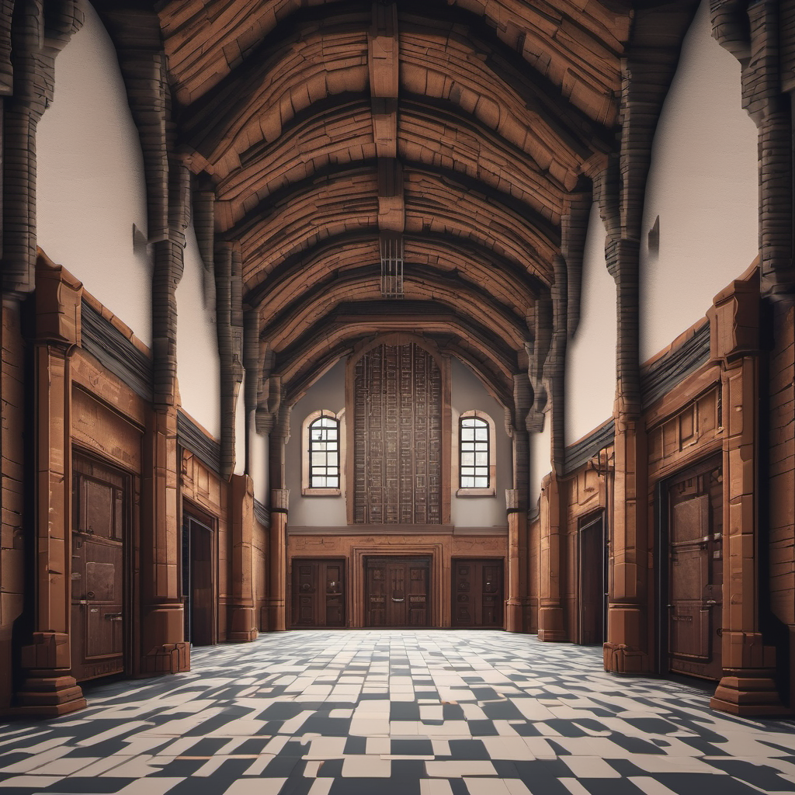
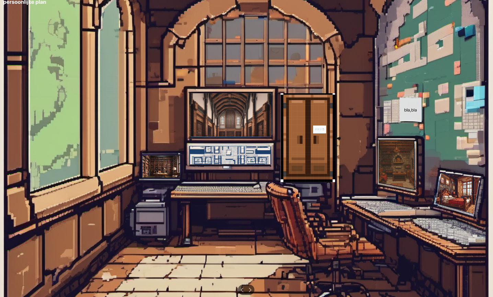
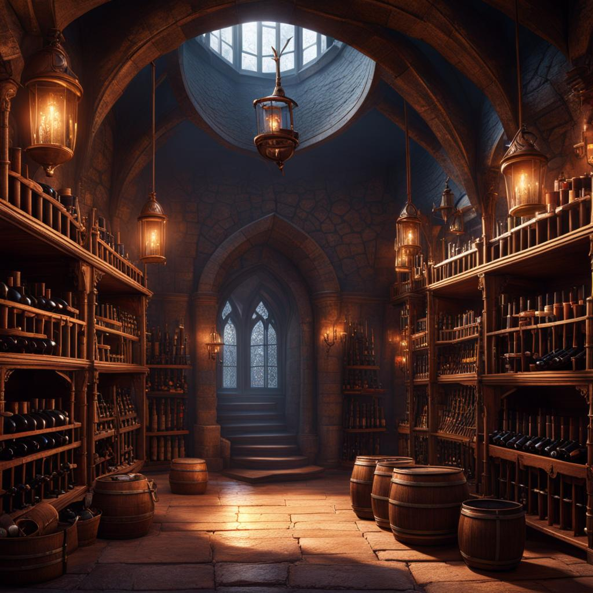

# Gamedesign

> ## Inhoudsopgave
> ## Inhoudsopgave
> - [Gamedesign](#gamedesign)
>   - [Inhoudsopgave](#inhoudsopgave)
>   - [Verhaallijn](#verhaallijn)
>     - [Introductie](#introductie)
> - [Layout (Map)](#layout-map)
> - [Game Plot](#game-plot)
>   - [Main hall entrance](#main-hall-entrance)
>   - [Control room](#control-room)
>   - [Library](#library)
>   - [Bedroom](#bedroom)
>   - [Storage room](#storage-room)
>   - [Einde (Secret room)](#einde-secret-room)
> - [Gameplay](#gameplay)
> - [Objecten](#objecten)
>   - [Bedroom](#bedroom-1)
>   - [Storage room](#storage-room-1)
>   - [Control room](#control-room-1)
>   - [Library](#library-1)
>   - [Main Room](#main-room-1)
> - [Bronnen](#bronnen)

> ## Verhaallijn
> 
> ### Introductie
> Het is een kille middag in de winter van 1932, de zon hangt laag aan de hemel en werpt lange schaduwen over de straten van New York. Detective William McCarthy zit achter zijn bureau, omringd door stapels dossiers en krantenknipsels, terwijl John Manny, zijn trouwe assistent, druk bezig is met het organiseren van de laatste details voor hun aanstaande expeditie.
>
> Het geluid van rinkelende telefoons en het getik van de typemachine vult de lucht, terwijl McCarthy zijn gedachten laat dwalen naar de zaak die hem al zo lang achtervolgt - de jacht op een meedogenloze seriemoordenaar. Deze moordenaar heeft een spoor van dood en verderf achtergelaten in de straten van de stad, en McCarthy is vastbesloten om hem te stoppen, koste wat het kost.
> 
> Na maanden van intensief onderzoek heeft McCarthy eindelijk een doorbraak bereikt. Een tip heeft hem geleid naar een oud kasteel aan de rand van de stad, een plek die verondersteld wordt het toevluchtsoord te zijn van de moordenaar die hij zo wanhopig zoekt.
>
> Met een vastberaden blik in zijn ogen staat McCarthy op, zijn jas aantrekkend terwijl hij zijn revolver controleert, klaar voor de missie die voor hen ligt. John kijkt op naar zijn mentor, een mengeling van opwinding en nervositeit op zijn gezicht, terwijl hij zich voorbereidt op de uitdaging die voor hen ligt.
> 
> De middagzon werpt lange schaduwen over de verlaten straten terwijl McCarthy en John zich een weg banen naar het kasteel, vastberaden om de confrontatie aan te gaan met het kwaad dat zich verschuilt binnen de eeuwenoude muren.
> 
> Het geluid van hun voetstappen echoot door de stille gangen van het kasteel, terwijl ze zich dieper en dieper wagen in de duisternis van het onbekende. Voor McCarthy is het een laatste kans om zijn naam te zuiveren, om de waarheid te achterhalen en om gerechtigheid te laten zegevieren.
> 
> Maar wat ze binnen in het kasteel zullen vinden, is meer dan alleen maar duisternis en geheimen. Het is een strijd op leven en dood, een confrontatie met het onbekende dat hun lot zal bepalen en de waarheid zal onthullen die al die tijd verborgen lag in de schaduwen.
>
> Gewapend met moed en vastberadenheid gaan ze de confrontatie aan, vastbesloten om het mysterie te ontrafelen en de rechtvaardigheid te laten zegevieren, zelfs als dat betekent dat ze zichzelf moeten opofferen voor het hogere doel.
>
> De middagzon begint langzaam onder te gaan, maar de strijd is nog lang niet gestreden. In de schaduwen van het kasteel zullen ze hun lot onder ogen moeten zien, en alleen de tijd zal uitwijzen of gerechtigheid zal zegevieren in de duisternis van de middag.
> 
> 
> # Layout (Map)
> **Figma Storyboard**  
> In de Figma Storyboard, die beschikbaar is via de gegeven [link](https://www.figma.com/file/wD1ZWz86XNqWshWgEOX6RZ/Untitled?type=design&node-id=0%3A1&mode=design&t=V2ffvexNHoPi7Yau-1), wordt een gedetailleerde visualisatie gegeven van de lay-out van het verlaten kasteel en de verschillende kamers die spelers kunnen verkennen. Hieronder vind je een samenvatting van wat er allemaal wordt weergegeven:   
>
> De afbeeldingen tonen een gedetailleerde plattegrond van het verlaten kasteel, inclusief de indeling van de kamers, gangen en eventuele verborgen doorgangen. Elke kamer is duidelijk gemarkeerd en genummerd, waardoor spelers gemakkelijk kunnen navigeren door het kasteel tijdens hun avontuur.
>
> 
> 
>
> # Game Plot
> 
> ## Main hall entrance
>  
> 
> ### Introductie:
> De Main Hall van het verlaten kasteel is een majestueuze ruimte, met hoge plafonds en donkere, statige muren die getuigen van vervlogen glorie. Een imposante kroonluchter hangt in het midden van de hal, haar kristallen glinsteren zwak in het schaarse licht dat door de ramen valt. De Main Hall lijkt het hart van het kasteel te zijn, een centrale ontmoetingsplaats die ooit levendig was maar nu doordrenkt is van stilte en mysterie.
>
> ### Plot:
> 
> **Toegangspoort tot Geheimen:**  
> Via de imposante Main Hall hebben William en John toegang gekregen tot de verschillende kamers van het kasteel. Elke kamer heeft een cruciaal cijfer onthuld dat deel uitmaakt van de viercijferige pincode voor de Secret Room. Alleen door elk van deze kamers te verkennen en de aanwijzingen te ontcijferen, kunnen ze de ultieme waarheid onthullen die het kasteel omringt.
>
> **Ontmoeting met het Laatste Mysterie:**  
>  De Main Hall vormt het decor voor de laatste confrontatie van William en John met het mysterie van het verlaten kasteel. Hier komen alle aanwijzingen en puzzelstukjes samen, waar ze worden uitgedaagd om de ultieme puzzel op te lossen en de waarheid te onthullen die het kasteel omhult.
>
> **De Sleutel tot de Waarheid:**  
> In de Main Hall moeten William en John al hun verzamelde aanwijzingen en sleutels gebruiken om de geheimen van het kasteel te doorgronden. Het is een cruciale ruimte waar de waarheid binnen handbereik lijkt te zijn, maar alleen toegankelijk is voor degenen die moedig genoeg zijn om de confrontatie aan te gaan met de seriemoodernaar.
>
> ### Conclusie:
> Na het ontrafelen van de laatste puzzels en het vinden van de ontbrekende stukjes van de puzzel, openen William en John uiteindelijk de geheime kamer in de Main Hall. Hier vinden ze niet alleen de laatste aanwijzingen die leiden tot de ontmaskering van de seriemoordenaar, maar ook een onthullende confrontatie die het ultieme slot vormt van hun avontuur.
> 
>
> ## Control Room
>  
> 
> ### Introductie:
> De controlekamer in het oude kasteel dient als het centrale commandocentrum waar alle activiteiten worden gemonitord en gecontroleerd. Een wirwar van bewakingscamera's, schermen en notities van eerdere onderzoekers vult de ruimte, waar de geheimen van het kasteel op het punt staan onthuld te worden.
>
> ### Plot:
> 
> In de controlekamer begint het echte onderzoek naar het mysterie van het kasteel. Detectives hebben toegang tot een scala aan middelen om aanwijzingen te vinden en puzzels op te lossen:
> 
> **Bewakingscamera's (Cams):**  
> Elke camera biedt een uniek perspectief op de kasteelgronden of de binnenkamers behalve de secret room, waardoor spelers hints kunnen krijgen over verborgen voorwerpen of verdachte activiteiten.
> 
> **Sticky Notes (Plakbriefjes):**  
> Verspreid over de kamers liggen plakbriefjes met cruciale informatie voor het oplossen van puzzels en het voortzetten van het onderzoek.
> 
> **Inhoud van de Afgesloten Kast:**  
> De afgesloten kast bevat waardevolle items die de sleutel kunnen zijn tot het ontrafelen van het mysterie. De combinatie of pincode kan verborgen zijn in de bibliotheek of andere delen van het kasteel.
> 
> **Blauwdruk (Blueprint):**  
> De blauwdruk biedt een overzicht van de kasteelindeling en kan aanwijzingen bevatten over verborgen doorgangen of belangrijke locaties.
Spelers moeten slim gebruik maken van deze middelen en aanwijzingen combineren om stap voor stap het grote mysterie van het kasteel te ontrafelen.
>
> ### Koppeling met andere kamers:
> **Library:**  
>  De controlekamer biedt de locatie van de drie boeken die nodig zijn om de geheime kast in de bibliotheekkamer te openen. Dit vormt een essentiële schakel tussen de controlekamer en de bibliotheek.
>
> ### Conclusie:
> De controlekamer vormt het hart van het onderzoek naar het kasteelmysterie. Door strategisch objecten en aanwijzingen te gebruiken, kunnen spelers geleidelijk aan de geheimen van het oude kasteel onthullen. De meeslepende omgeving en complexe puzzels houden spelers betrokken terwijl ze de waarheid achterhalen en de spanning naar een climax opbouwen. 
>
>
> ## Library
>  
> 
> ### Introductie:
> De bibliotheekkamer is een verweerde ruimte in een oud herenhuis in New York. Stoffige boekenkasten strekken zich uit langs de muren, en het geheime verleden van het huis lijkt tussen de pagina's van de vergeten boeken te fluisteren.
>
> ### Plot:
>
> **De Aanwijzingen van de Control Room:**  
> De speler, detective John Manny met zijn assistent William McCarthy, begint in de control room, waar hij een cryptische boodschap ontvangt over drie essentiële boeken die nodig zijn om een geheime kast in de bibliotheekkamer te openen.
>
> **Het Ontbrekende Boek:**  
> Bij het onderzoeken van de bibliotheekkamer merkt John dat één van de benodigde boeken ontbreekt. Hij realiseert zich al snel dat het ontbrekende boek zich in de bedroom bevindt, en het heeft een essentiële pagina met een nummer voor de pincode.
>
> **Het Vinden van de Paginanummers:**  
> De speler moet elk van de drie boeken vinden en het paginanummer identificeren dat is omcirkeld, wat cruciaal is voor het ontcijferen van de pincode voor de geheime kast.
>
> **De Onthulling van de Verborgen Pincode:**  
> Wanneer de speler het licht in de bibliotheekkamer uitschakelt, wordt een verborgen pincode zichtbaar op een subtiel verlicht paneel, waarmee de control room-kast kan worden geopend. Deze code verschijnt als een resultaat van het uitschakelen van het licht in de bibliotheek.
>
> **De Puzzel van de Geheime Kast:**  
Na het verzamelen van de boeken en de paginanummers, opent de speler eindelijk de geheime kast in de boekenkast. Binnenin wacht een intrigerende puzzel die de detective moet oplossen om het ontbrekende cijfer van de pincode te vinden. Tijdens het openen van de geheime kast worden ook gegevens over de seriemoordenaar onthuld, waardoor John nog dichter bij de waarheid komt.
>
> **Onthullingen en Beloningen:**  
> Na het oplossen van de puzzel, onthult de geheime kast een cruciale aanwijzing over de identiteit of het motief van de seriemoordenaar, waardoor John dichter bij de waarheid komt.
>
> ### Koppeling met andere kamers:
>
> **Bedroom:**  
> Het ontbrekende boek dat nodig is voor het oplossen van de puzzel bevindt zich in de bedroom. Dit vormt een cruciale schakel in het verhaal, omdat het de speler naar het nummer voor de pincode leidt.
>
> **Control room:** 
> Wanneer het licht in de bibliotheekkamer wordt uitgeschakeld, wordt de pincode zichtbaar die nodig is om de geheime kast in de control room te openen. Dit verbindt de bibliotheek direct met de control room, waar verdere onthullingen wachten.
>
> ### Conclusie:
> De bibliotheekkamer biedt niet alleen een uitdagende puzzel voor de speler om op te lossen, maar onthult ook belangrijke informatie die het verhaal verder drijft en de spanning opbouwt naar de climax van het avontuur. 
>
> ## Bedroom
>  
> 
> ### Introductie:
> De Slaapkamer binnen het herenhuis lijkt recent gebruikt te zijn; stof zweeft in de lucht en de enige verlichting komt van de zonnestralen die door het raam schijnen.
>
> ### Plot:
> **Geen zicht:**  
> Tijdens het onderzoeken van de slaapkamer valt McCarthy op dat het moeilijk te doorzoeken is vanwege de beperkte verlichting. Gelukkig vindt hij batterijen in het nachtkastje, waarmee hij de zaklamp kan gebruiken om de kamer verder te onderzoeken.
>
> **Het verloren boek:**  
> Terwijl McCarthy de slaapkamer doorzoekt, ontdekt hij onder het bed een verloren boek. Dit boek bevat een cruciaal stukje code voor de pincode van de bibliotheek, waardoor McCarthy dichter bij het oplossen van het mysterie komt.
>
> **Achtergelaten fles:**  
> Tijdens verdere inspectie van de slaapkamer stuit McCarthy op een wijnfles in de kledingkast. Het lijkt erop dat deze fles een connectie heeft met de opslagruimte en mogelijk een hint bevat voor het vinden van belangrijke items.
>
> **Verborgen brief:**  
> In het nachtkastje ontdekt McCarthy een brief met een cijfer geschreven in Romeinse cijfers. Dit cijfer vormt een deel van de code die nodig is om toegang te krijgen tot de secret room.
>
> ### Koppeling met andere kamers:  
> *Storage room:* De wijnfles in de kledingkast van de slaapkamer dient als een hint voor het vinden van aanwijzingen in de storage room, waar een deel van de pincode voor de secret room verborgen ligt.
>
> ### Conclusie:
> De slaapkamer biedt McCarthy niet alleen essentiële items zoals batterijen voor de zaklamp en het verloren boek met code, maar ook aanwijzingen zoals de achtergelaten wijnfles en de verborgen brief met het Romeinse cijfer. Deze ontdekkingen brengen hem dichter bij het oplossen van het mysterie en onthullen meer over het duistere verleden van het herenhuis.
>
>
> ## Storage room
>  
> ### Introductie:
> De storage room is een donkere en stoffige ruimte binnen het oude kasteel, gevuld met vergeten voorwerpen en verborgen schatten. Het geluid van krakende vloerplanken vult de lucht terwijl de speler de kamer verkent, op zoek naar aanwijzingen en puzzels om op te lossen. In deze kamer bevinden zich meerdere rekken met wijnflessen, waarvan sommige mogelijk cruciale aanwijzingen bevatten.
>
> ### Plot:
> **Speciale wijnflessen vinden:**  
> De speler wordt geconfronteerd met verschillende rekken vol met wijnflessen in verschillende kleuren. Om de code te ontcijferen voor het hangslot, moeten de speciale wijnflessen worden gevonden. Echter, één van deze flessen blijkt zich niet in de storage room te bevinden, maar in de bedroom, wat de uitdaging vergroot.
>
> **Jaartallen op de speciale wijnflessen:**  
> Binnen de kamer staan 3 speciale wijnflessen, elk gemarkeerd met een jaartal. Deze jaartallen vormen samen een code voor het hangslot van de kist. De speler moet de flessen ordenen op jaartal en van elke fles het laatste cijfer nemen om de code te vormen.
>
> ### Koppeling met andere kamers:
> **Bedroom:**  
> Een van de speciale wijnflessen die nodig zijn voor het oplossen van de puzzel bevindt zich in de bedroom. Dit fungeert als een hint voor de speler, waarbij de kleur van deze fles aangeeft welke kleur wijnflessen gezocht moeten worden in de storage room.
>
> **Secret room:**  
> Binnen de kist in de storage room bevindt zich een deel van de pincode die nodig is om toegang te krijgen tot de secret room, waar de ultieme uitdaging wacht.
>
> ### Conclusie:
> De storage room biedt een intrigerende omgeving vol met rekken gevuld met wijnflessen, die niet alleen dienen als decoratie maar ook als cruciale elementen in het ontrafelen van het mysterie van het kasteel. Door het onderzoeken van de wijnflessen en het vinden van aanwijzingen, kan de speler een stap dichter bij de onthulling van de waarheid komen.
>
> ## Einde (Secret room)
> Na het onthullen van de waarheid en oplossen van alle mysteries, ontsnappen William en John uit het kasteel en slagen ze erin de dader te ontmaskeren. Met de waarheid aan het licht en gerechtigheid gediend, keren ze terug naar de bewoonde wereld, wetende dat ze een groot mysterie hebben opgelost.
>
> Met de gevonden cijfers van de pincode van de secret room, slagen William en John erin om de seriemoordenaar te confronteren en uiteindelijk te laten arresteren door de autoriteiten. Hun vastberadenheid en toewijding hebben geleid tot gerechtigheid, en ze kunnen terugkeren naar de bewoonde wereld in de wetenschap dat ze een groot mysterie hebben opgelost en de samenleving veiliger hebben gemaakt.
> 
> ## Gameplay
> William en John reizen naar een verlaten kasteel nadat ze een anonieme brief hebben ontvangen. Zodra ze binnenstappen, sluiten de deuren meteen en staan ze voor de uitdaging om binnen een bepaalde tijd een puzzel op te lossen. Je hebt de volgende kamers:
> 
> Main room entrance
> - Bedroom
> - Storage room
> - Library
> - Control room
> 
> Daarbuiten is er ook de secret room, waar de seriemoordenaar zich schuilhoudt.
>
> Binnen deze 5 kamers moeten spelers verschillende puzzels oplossen door items te verzamelen en objecten te inspecteren. De bedoeling is dat je uiteindelijk binnen de Main Room de code zelf kunt invoeren via een machine. Als de combinatie correct is, opent een geheime kamer en wint de speler de game.
> 
> De gameplay is doordrenkt met spanning en mysterie, waarbij elke kamer nieuwe aanwijzingen en uitdagingen biedt. Door slim gebruik te maken van verzamelde informatie en observaties, kunnen spelers de waarheid onthullen en het kwaad dat het kasteel bewoont ontmaskeren. Succesvolle voltooiing van de puzzels leidt tot een spannende ontsnapping uit het kasteel en het ontmaskeren van de dader, waardoor gerechtigheid wordt gediend en het mysterie wordt opgelost.

> # Objecten
> Hieronder noteren we de afgesproken objecten binnen de kamers die je nodig zal hebben voor de story. 
> 
> ### Bedroom
> - Zaklamp
> - Batterijen voor de zaklamp
> - Missende boek voor pin-code geheime kast(library)
> - 1 missende speciale wijnfles voor hangslot(Storage room)
> - Brief met een romeinse getal voor pincode(secret room)
> 
> ### Storage room
> - Kist met hangslot 
> - 3 Speciale wijnflessen. 
> 
> ### Control room
> - Bewakingscamera's
> - Sticky Notes (Plakbriefjes)
> - Inhoud van de afgesloten kast
> - Blauwdruk van het kasteel
> 
> ### Library
> - 3 Boeken. 
> - Pincode voor kast (control room)
> - Gegevens van de seriemoordenaar 
> - Puzzlestukje in de geheime kast achter de boekenkast
> 
> ### Main hall entrance
> - Code Device

> # Planning
> - 

> ## Bronnen
> - [Figma](https://www.figma.com/)
> - [Ai image generator](https://pixlr.com/image-generator/)
> - [Google voor meerdere afbeeldingen](https://www.google.com/)