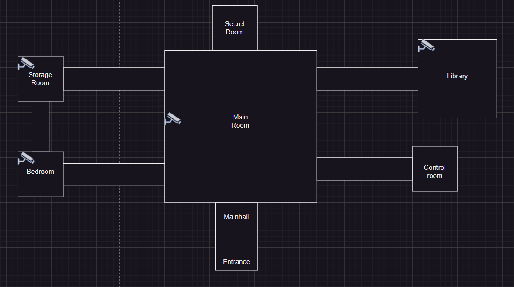
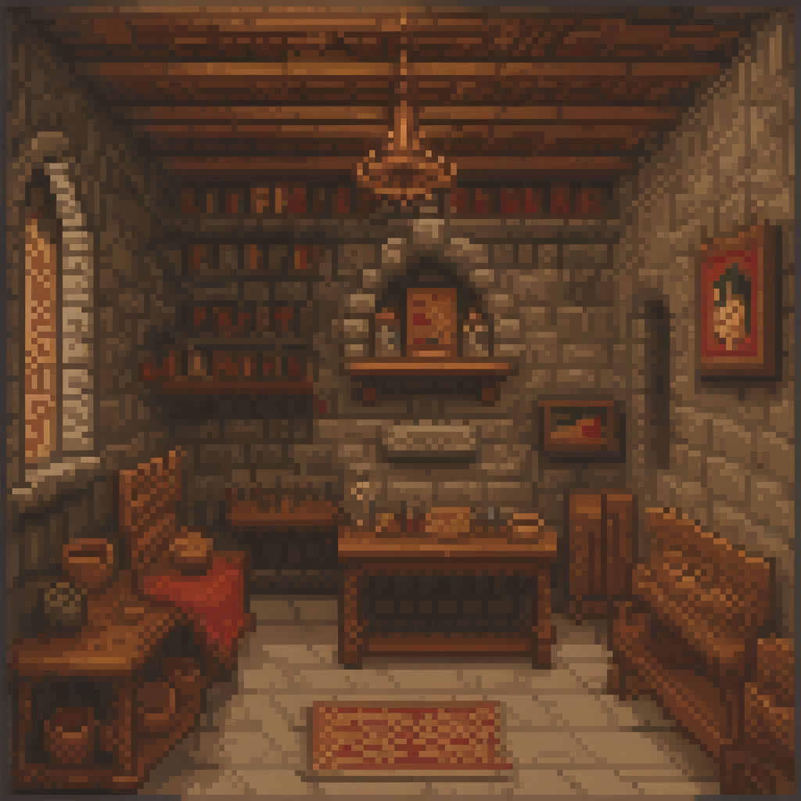
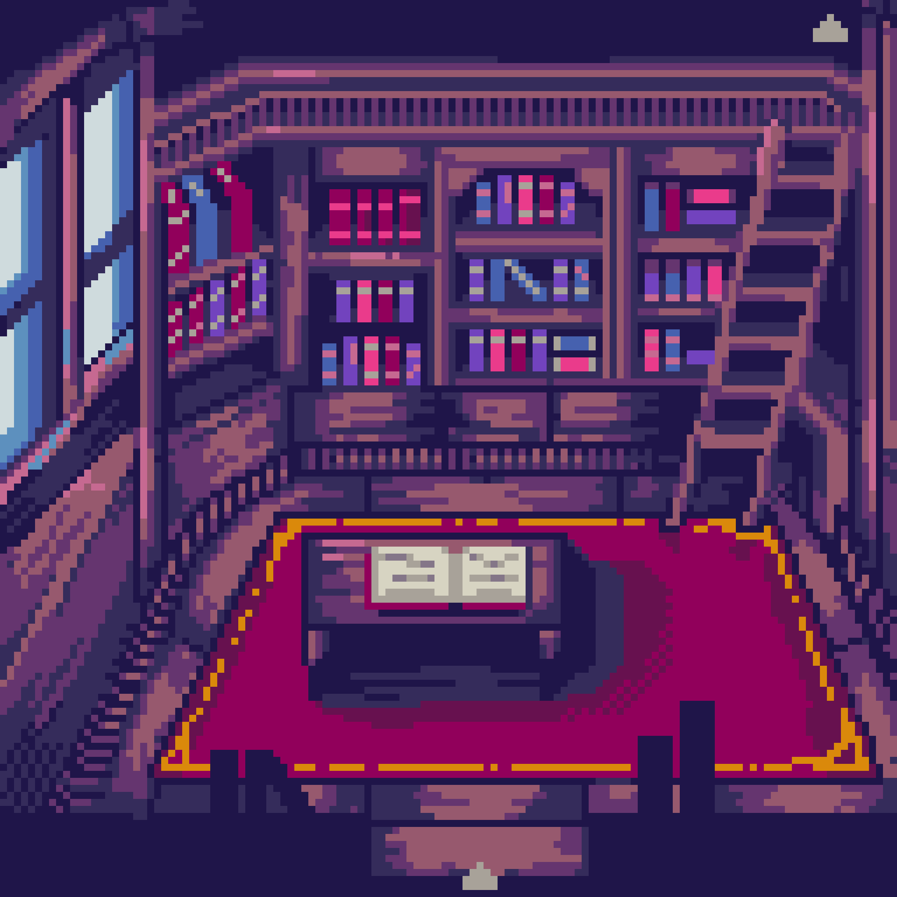
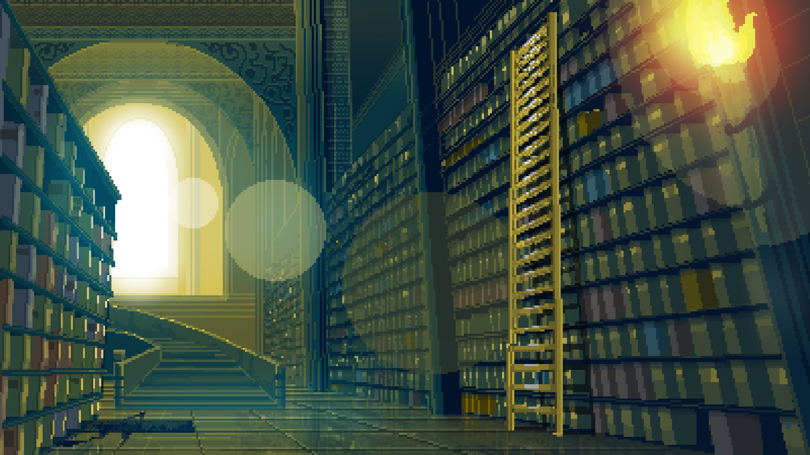

# Gamedesign
## Inhoudsopgave
- [Gamedesign](#gamedesign)
  - [Inhoudsopgave](#inhoudsopgave)
  - [Concept](#concept)
  - [Verhaallijn](#verhaallijn)
- [Introductie](#introductie)
- [Game Plot](#game-plot)
- [Einde](#einde)
  - [Gameplay](#gameplay)
  - [Functies](#functies)
  - [Layout](#layout)
  - [Objecten](#objecten)
    - [Bedroom](#bedroom)
    - [Storage Room](#storage-room)
    - [Control Room](#control-room)
    - [Library](#library)
    - [Main Room](#main-room)
  - [Images](#images)
    - [Kamers](#kamers)
      - [Bedroom Image](#bedroom-image)
      - [Storage Room Image](#storage-room-image)
      - [Library Image #1](#library-image-1)
      - [Library Image #2](#library-image-2)
      - [Control Room Image](#control-room-image)
      - [Main Room Image](#main-room-image)
    - [Objecten](#objecten-1)

## Concept
Het concept is dat je speelt als een detective in 1932, tijdens de Grote Depressie in New York. Je hebt de keuze uit 1-3 zaken waarin je zelf onderzoek gaat doen. Je kunt ervoor kiezen om langs de plaats delict te gaan om bewijs te verzamelen en langs verschillende verdachten om vragen te stellen en, indien mogelijk, ze te confronteren op basis van het verzamelde bewijs. 

## Verhaallijn
# Introductie
Het is 1932 in New York, en je speelt als intern detective William McCarthy dat onder de begeleiding van John Manny, een van de meest successvolste detectives, werkt. Hij is bekend om de feit dat hij vreemde cases op zich neemt en alles heeft kunnen oplossen. Nu is het zo dat hij jaren lang een seriemoordenaar achtervolgt en eindelijk een locatie heeft kunnen vinden waar alles een einde aan de case kan zetten. 

# Game Plot

# Einde

## Gameplay
William en John reizen richting een verlaten kasteel na dat ze een anoniem brief hadden gekregen. Zodra ze binnen stappen sluiten de deuren meteen en moeten ze binnen een timer een puzzel oplossen. Je hebt de volgende kamers: 

- Main Room 
- Bedroom 
- Storage Room 
- Library 
- Control Rooom 

Daarbuiten heb je ook de secret room en de main hall maar die zijn niet included omdat ze buiten de gameplay vallen. 

Binnen deze 5 kamers moet je verschillende puzzels zien op te lossen door items te verzamelen en dingen te inspecteren. De bedoeling is dat je uiteindeleijk binnen de Main Room de code zelf kunt intikken binnen een machine, en als de combinatie klopt opent een geheime kamer, waardoor je de game wint. 

## Functies

- Wij zullen als groep elk 1 kamer developen binnen de game. 
- Hintoptie als een speler vastloopt. 
- Je kunt een kamer bestuderen voor bewijs. 
- Je kunt verschillende objecten inspecteren, zoals in een kast kijken, onder de bank controleren, enzovoort. 
- Er is een timer, als de timer op nul tikt explodeert heel het gebouw wat leid tot een game over. Vervolgens moeten dan de spelers terug naar de begin gaan. 
- Binnen de control room kan je camera's gebruiken om beelden van kamers te bekijken. 
(Potentieel Idee: Misschien kunnen we een soortvan filter implementeren bij de cameras om dingen te onthullen wat je niet zou kunnen zien met de menselijk oog) 
- Binnen de library zou je een boek kunnen lezen waar hints en een puzzel erin zou kunnen zitten. 
- Binnen de main room heb je een device waar je een code kunt intypen, na 3 mislukte pogingen zou je ook een game over kunnen krijgen. 
- De Storage Room en Bedroom zijn meer zelfsprekend in de zin van dat ze meer bedoelt zijn om geinspecteerd te zijn voor objecten. 
- Sommige objecten die je vind in kamers hebben niets te maken met de plek waar ze zijn gevonden, maar juist heel ergens anders.  
(Bijvoorbeeld als je een stuk van een spiegel vindt binnen de storage room moet je het juist binnen de bedroom gebruiken.) 

## Layout
* Kamer Layout
 

## Objecten
Hieronder noteren we de afgesproken items binnen de kamers.

### Bedroom
- 
### Storage Room
- 
### Control Room
- 
### Library
- 
### Main Room
- 

## Images
Hieronder noteren we de images die wij gaan gebruiken binnen de game. (Inclusief potentiële images) 
### Kamers
#### Bedroom Image
 
#### Storage Room Image
 
#### Library Image #1
 
#### Library Image #2
 
#### Control Room Image
 
#### Main Room Image
 
### Objecten