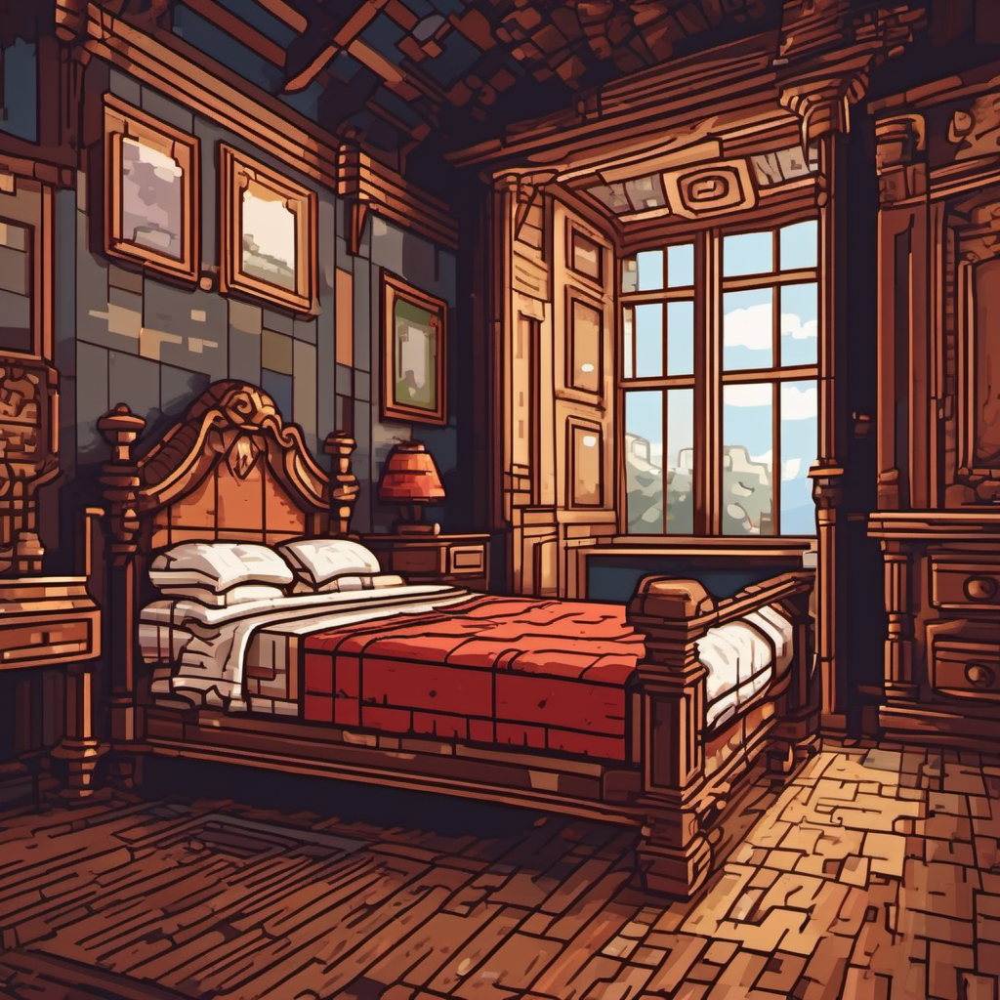

# Gamedesign
## Inhoudsopgave
- [Gamedesign](#gamedesign)
  - [Inhoudsopgave](#inhoudsopgave)
  - [Concept](#concept)
  - [Verhaallijn](#verhaallijn)
- [Introductie](#introductie)
- [Game Plot](#game-plot)
    - [Bibliotheek](#bibliotheek)
    - [Storage Room](#storage-room)
    - [Control Room](#control-room)
- [Einde](#einde)
  - [Gameplay](#gameplay)
  - [Functies](#functies)
  - [Layout](#layout)
  - [Objecten](#objecten)
    - [Bedroom](#bedroom)
    - [Storage Room](#storage-room-1)
    - [Control Room](#control-room-1)
    - [Library](#library)
    - [Main Room](#main-room)
  - [Images](#images)
    - [Kamers](#kamers)
      - [Bedroom Image](#bedroom-image)
      - [Storage Room Image](#storage-room-image)
      - [Library Image #1](#library-image-1)
      - [Library Image #2](#library-image-2)
      - [Control Room Image](#control-room-image)
      - [Main Room Image](#main-room-image)
    - [Objecten](#objecten-1)
  - [Bronnen](#bronnen)

## Concept
Het concept is dat je speelt als een detective in 1932, tijdens de Grote Depressie in New York. Je hebt de keuze uit 1-3 zaken waarin je zelf onderzoek gaat doen. Je kunt ervoor kiezen om langs de plaats delict te gaan om bewijs te verzamelen en langs verschillende verdachten om vragen te stellen en, indien mogelijk, ze te confronteren op basis van het verzamelde bewijs. 

## Verhaallijn
# Introductie
Het is 1932 in New York, en je speelt als intern detective William McCarthy dat onder de begeleiding van John Manny, een van de meest successvolste detectives, werkt. Hij is bekend om de feit dat hij vreemde cases op zich neemt en alles heeft kunnen oplossen. Nu is het zo dat hij jaren lang een seriemoordenaar achtervolgt en eindelijk een locatie heeft kunnen vinden waar alles een einde aan de case kan zetten. 

# Game Plot

### Bibliotheek
* Introductie: 

De bibliotheekkamer is een verweerde ruimte in een oud herenhuis in New York. Stoffige boekenkasten strekken zich uit langs de muren, en het geheime verleden van het huis lijkt tussen de pagina's van de vergeten boeken te fluisteren. 

* Plot: 

  **De Aanwijzingen van de Control Room**: De speler, als assistent William McCarthy samen met zijn mentor John Manny, begint in de control room, waar hij een cryptische boodschap ontvangt over drie essentiële boeken die nodig zijn om een geheime kast in de bibliotheekkamer te openen. 

  **Het Ontbrekende Boek**: Bij het onderzoeken van de bibliotheekkamer merkt McCarthy dat één van de benodigde boeken ontbreekt. Hij realiseert zich al snel dat het ontbrekende boek zich in de bedroom bevindt, en het heeft een essentiële pagina met een nummer voor de pincode.

  **Het Vinden van de Paginanummers**: De speler moet elk van de drie boeken vinden en het paginanummer identificeren dat is omcirkeld, wat cruciaal is voor het ontcijferen van de pincode voor de geheime kast. 

  **De Onthulling van de Verborgen Pincode**: Wanneer de speler het licht in de bibliotheekkamer uitschakelt, wordt een verborgen pincode zichtbaar op een subtiel verlicht paneel, waarmee de control room-kast kan worden geopend.
  De Puzzel van de Geheime Kast: Na het verzamelen van de boeken en de paginanummers, opent de speler eindelijk de geheime kast in de boekenkast. Binnenin wacht een intrigerende puzzel die de detective moet oplossen om het ontbrekende cijfer van de pincode te vinden. 

  **Onthullingen en Beloningen**: Na het oplossen van de puzzel, onthult de geheime kast een cruciale aanwijzing over de identiteit of het motief van de seriemoordenaar, waardoor McCarthy dichter bij de waarheid komt. 

* Conclusie: 

  De bibliotheekkamer biedt niet alleen een uitdagende puzzel voor de speler om op te lossen, maar onthult ook belangrijke informatie die het verhaal verder drijft en de spanning opbouwt naar de climax van het avontuur. 

### Storage Room
  * Objecten 
    Kist met hangslot 
    Speciale wijnflessen. 

* Plot:  
  
  **Speciale wijnflessen vinden**: In de kamer staat een wijnrek gevuld met wijnflessen in verschillende kleuren. Aan de speler om de juiste kleur wijnflessen (de speciale) te vinden om de code te kunnen ontcijferen voor het hangslot. 1 van de benodigde wijnflessen bevind zich echter niet in de storage room maar in de bedroom. 

  **Jaartallen op de speciale wijnflessen**: Er staan 3 speciale wijnflessen in de kamer. Op elke wijnfles staat een jaartal. Een deel van de jaartallen geeft samen een code voor het hangslot van de kist. Aan de speler om de wijnflessen te rangschikken op jaartal. Van elke fles het laatste cijfer van het jaartal nemen welke samengesteld de code van het hangslot vormen. 

* Koppeling met andere rooms:  
  **Bedroom**: Een van de benodigde speciale wijnflessen bevind zich in de bedroom. Dit is tevens ook gelijk een hint; als je deze fles hebt weten te bemachtigen kan je aan de kleur van die fles bepalen welke kleur wijnflessen je in de storage room moet bemachtigen. 

  **Endroom**: In de kist bevind zich een deel van de sleutel die nodig is om de end room te betreden. 

### Control Room
* Introductie:

* Plot: 

  De controlekamer in het oude kasteel is als het hoofdkwartier voor alles wat er gebeurt. Als detective moeten spelers door aanwijzingen in de kamer gaan om de geheimen van het kasteel te ontdekken. Er zijn bewakingscamera's, schermen en veel notities van vorige mensen. Spelers moeten de berichten begrijpen en de aanwijzingen combineren om het grote mysterie op te lossen. 

  Door strategisch objecten en aanwijzingen door de controlekamer te plaatsen, worden spelers aangemoedigd om elk hoekje en gaatje te verkennen en zo stap voor stap het mysterie te ontrafelen. De meeslepende omgeving en ingewikkelde puzzels houden spelers betrokken terwijl ze de geheimen van het oude kasteel ontrafelen. 

* Conclusie:  
# Einde

## Gameplay
William en John reizen richting een verlaten kasteel na dat ze een anoniem brief hadden gekregen. Zodra ze binnen stappen sluiten de deuren meteen en moeten ze binnen een timer een puzzel oplossen. Je hebt de volgende kamers: 

- Main Room 
- Bedroom 
- Storage Room 
- Library 
- Control Rooom 

Daarbuiten heb je ook de secret room en de main hall maar die zijn niet included omdat ze buiten de gameplay vallen. 

Binnen deze 5 kamers moet je verschillende puzzels zien op te lossen door items te verzamelen en dingen te inspecteren. De bedoeling is dat je uiteindeleijk binnen de Main Room de code zelf kunt intikken binnen een machine, en als de combinatie klopt opent een geheime kamer, waardoor je de game wint. 

## Functies

- Wij zullen als groep elk 1 kamer developen binnen de game. 
- Hintoptie als een speler vastloopt. 
- Je kunt een kamer bestuderen voor bewijs. 
- Je kunt verschillende objecten inspecteren, zoals in een kast kijken, onder de bank controleren, enzovoort. 
- Er is een timer, als de timer op nul tikt explodeert heel het gebouw wat leid tot een game over. Vervolgens moeten dan de spelers terug naar de begin gaan. 
- Binnen de control room kan je camera's gebruiken om beelden van kamers te bekijken. 
(Potentieel Idee: Misschien kunnen we een soortvan filter implementeren bij de cameras om dingen te onthullen wat je niet zou kunnen zien met de menselijk oog) 
- Binnen de library zou je een boek kunnen lezen waar hints en een puzzel erin zou kunnen zitten. 
- Binnen de main room heb je een device waar je een code kunt intypen, na 3 mislukte pogingen zou je ook een game over kunnen krijgen. 
- De Storage Room en Bedroom zijn meer zelfsprekend in de zin van dat ze meer bedoelt zijn om geinspecteerd te zijn voor objecten. 
- Sommige objecten die je vind in kamers hebben niets te maken met de plek waar ze zijn gevonden, maar juist heel ergens anders.  
(Bijvoorbeeld als je een stuk van een spiegel vindt binnen de storage room moet je het juist binnen de bedroom gebruiken.) 

## Layout
* Kamer Map 
 

* Figma Storyboard 
[Link Figma]() 

* Wireframe 
 

## Objecten
Hieronder noteren we de afgesproken items binnen de kamers. 

### Bedroom
- Zaklamp. 
- Boek. 
- Wijn Fles. 

### Storage Room
- Kist met hangslot 
- Speciale wijnflessen. 

### Control Room
- 
### Library
- 3 Boeken. 
- Control Room Pincode. 
- Puzzle piece in de geheime kast. 

### Main Room
- Post It note

## Images
Hieronder noteren we de images die wij gaan gebruiken binnen de game. (Inclusief potentiële images) 
### Kamers
#### Bedroom Image
 
#### Storage Room Image
 
#### Library Image #1
 
#### Library Image #2
 
#### Control Room Image
 
#### Main Room Image
 
### Objecten

## Bronnen