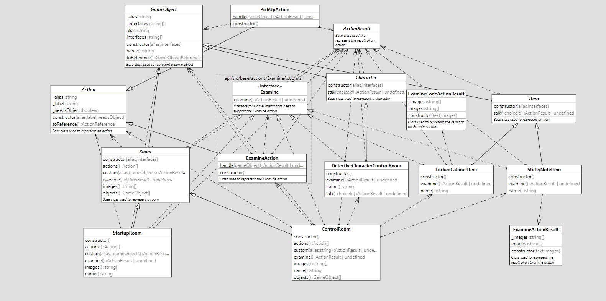
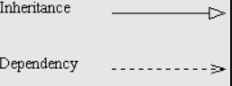

 
## Inleiding
Met deze documentatie toon ik de bewijzen voor de expert review van sprint 1.
 
## Learning stories  
Hier toon ik de learning stories die ik gedaan heb. Eerst leg ik de onderdelen uit en toon ik gerelateerde ingekorte code snippetd en daarna toon ik een UML-diagram.
 

> - [#11 Als student wil ik leren hoe ik de OO-principes abstraction, encapsulation en inheritance toepas in mijn code](https://gitlab.fdmci.hva.nl/propedeuse-hbo-ict/onderwijs/2023-2024/out-d-se-gd/blok-3/jooduumeenii48/-/issues/11)
> - [#12 Als student wil ik leren hoe ik het OO-principe polymorfisme toepas in mijn code](https://gitlab.fdmci.hva.nl/propedeuse-hbo-ict/onderwijs/2023-2024/out-d-se-gd/blok-3/jooduumeenii48/-/issues/12)
> - [#13 Als student wil ik leren hoe ik abstracte classes toepas in mijn code](https://gitlab.fdmci.hva.nl/propedeuse-hbo-ict/onderwijs/2023-2024/out-d-se-gd/blok-3/jooduumeenii48/-/issues/13)
>  - [#14 Als student wil ik leren hoe ik static functies en variabelen gebruik in mijn code](https://gitlab.fdmci.hva.nl/propedeuse-hbo-ict/onderwijs/2023-2024/out-d-se-gd/blok-3/jooduumeenii48/-/issues/14)
>  - [#15 Als student wil ik leren hoe ik interfaces toepas in mijn code](https://gitlab.fdmci.hva.nl/propedeuse-hbo-ict/onderwijs/2023-2024/out-d-se-gd/blok-3/jooduumeenii48/-/issues/15)
>  - [#16 Als student wil ik leren wat generics zijn en hoe ik ze gebruik in mijn code](https://gitlab.fdmci.hva.nl/propedeuse-hbo-ict/onderwijs/2023-2024/out-d-se-gd/blok-3/jooduumeenii48/-/issues/16)


 
 
#### Abstraction
Abstractie houdt in dat je alleen de nodige informatie voor je programma in de classes stopt en dat je overbodige informatie weglaat.
 
<details>
<summary>Code snippet Abstraction</summary>  
 
Hierbij wordt een class getoond die een child van de parent class Item is. Dit is terug te zien aan het woord "extends".
 
Bij het instantiëren van deze class worden alleen de benodigde informatie gebruikt, waardoor deze voldoet aan abstractie. Dit is terug te zien aan de constructor.
 
```typescript
***
 
/**
* The Cam1Item class, extending the Item class
* This class implements the Examine interface, to handle the actions in the room.

*/
export class Cam1Item extends Item implements Examine {
    public constructor() {
        super(Cam1ItemAlias, ExamineActionAlias);
    }
    ***
 
}
```
</details>
 
#### Encapsulation
Inkapseling houdt in dat je gegevens die niet direct van buiten de class bewerkt mogen worden afschermt. Hierdoor beperk je de toegang en is het alleen nog mogelijk om dan de afgeschermde informatie via methodes van de class te krijgen.
 
Bij Inkapseling wordt gebruik gemaakt van public, private, en protected.
* "public" houdt in dat deze eigenschap of methode toegankelijk is voor de code buiten deze class. Als niks staat aangeduid dan is het in typescript standaard public.
* "private" houdt in dat deze eigenschap of methode niet toegankelijk is voor code buiten deze class en ook niet voor de child via inheritance.
* "protected" houdt in dat deze code niet voor alle code buiten deze class beschikbaar is, maar wel voor de child classes via inheritance.
 
<details>
<summary>Code snippet Encapsulation</summary>
  
```typescript
***
 

@customElement("game-canvas")
export class GameCanvas extends LitElement {
    // Private property encapsulating the current game state
    private gameState: GameState = {};


    // Public method to refresh the game state
    public async refreshState(): Promise<void> {
        // This method allows external components to trigger the refresh of the game state.
        // By making it public, other parts of the application can interact with the GameCanvas component
        // and initiate the update process when necessary.
        this.gameState = await getState();
        this.requestUpdate();
    }

    // Other methods and properties...
}

```
</details>
 
#### Inheritance
Erfenis houdt in dat classes methodes en eigenschappen van de parent class overnemen. Deze kunnen dan door de nieuwe child class gebruikt worden. Hierdoor is het hergebruiken van code veel gemakkelijker.
 
De eigenschappen kunnen geïnitieerd worden in de constructor door het wordt “super” te gebruiken. De methodes en eigenschappen kunnen, als deze in de parent class aangeduid zijn met public of protected, aangeroepen worden in de child door het woord “super” te gebruiken.
 
<details>
<summary>Code snippet Inheritance</summary>
 
Hierbij is te zien dat door gebruik te maken van "extends" erfenis toepast. De methodes en eigenschappen van de class "Room" worden dus hergebruikt in de "ControlRoom".
 
Door gebruik te maken van "super" in de "constructor" wordt de constructor van de parent class "Room" aangesproken voor variabelen die wij meegeven.
 
```typescript
 
***
/**
* The ControlRoom class, extending the base Room class
*/
export class ControlRoom extends Room, implements Examine {
    public constructor() {
        super(ControlRoomAlias, ExamineActionAlias);
    }

***
 
}
```
</details>
 
#### Polymorphism
Polymorfisme is het vermogen om dezelfde code te gebruiken voor verschillende datatypes. Het stelt objecten in staat om verschillende vormen of functionaliteiten te hebben, terwijl ze een gemeenschappelijke interface delen.

<details>
<summary>Code snippet Polymorphism</summary>

```typescript
// Parent class
class Animal {
    sound(): void {
        console.log("Animal makes a sound");
    }
}

// Child classes
class Dog extends Animal {
    sound(): void {
        console.log("Dog barks");
    }
}

class Cat extends Animal {
    sound(): void {
        console.log("Cat meows");
    }
}

// Polymorphic function
function makeSound(animal: Animal): void {
    animal.sound();
}

// Using the function with different objects
makeSound(new Dog()); // Output: Dog barks
makeSound(new Cat()); // Output: Cat meows
```

</details>

#### abstract
Een abstracte functie is een functie die wordt gedeclareerd in een klasse, maar geen implementatie heeft binnen die Class. In plaats daarvan moet de implementatie worden geleverd door afgeleide Class. 
<details>
<summary>Code snippet Abstract</summary>  
 
Deze TypeScript-code definieert een abstracte basisklasse genaamd Room.
 
wat betekent dat deze niet rechtstreeks kan worden geïnstantieerd maar dient als blauwdruk voor andere Class die ervan erven.
 
```typescript
***
/**
 * Base class used to represent a room
 *
 * @remarks Implements the Examine action by default
 */
export abstract class Room extends GameObject implements Examine {
    /**
     * Create a new instance of this room
     *
     * @param alias Alias of this room
     * @param interfaces List of interfaces this room implements
     */
    protected constructor(alias: string, ...interfaces: string[]) {
        super(alias, ...interfaces, ExamineActionAlias, );
    }
```
</details>

#### Static functions and variables
Static functions and variables belong to the class itself rather than instances of the class. They can be accessed without creating an instance of the class.

<details>
<summary>Code snippet Static functions and variables</summary>

```typescript
export class MathUtils {
    // Static variable
    static PI: number = 3.14159;

    // Static function to calculate the area of a circle
    static calculateCircleArea(radius: number): number {
        return this.PI * radius * radius;
    }
}

// Accessing static variables and calling static functions
console.log(MathUtils.PI); // Output: 3.14159
console.log(MathUtils.calculateCircleArea(5)); // Output: 78.53975

```

</details>

#### Interfaces
Interfaces define a contract for classes to follow. They describe the structure that classes must adhere to, including properties and methods.

<details>
<summary>Code snippet Interfaces</summary>

```typescript

// Define an interface for a shape
interface Shape {
    calculateArea(): number;
}

// Implement the interface for a Circle class
class Circle implements Shape {
    constructor(private radius: number) {}

    // Implementing the method required by the Shape interface
    calculateArea(): number {
        return Math.PI * this.radius * this.radius;
    }
}

// Implement the interface for a Rectangle class
class Rectangle implements Shape {
    constructor(private width: number, private height: number) {}

    // Implementing the method required by the Shape interface
    calculateArea(): number {
        return this.width * this.height;
    }
}

// Create instances of Circle and Rectangle
const circle = new Circle(5);
const rectangle = new Rectangle(4, 6);

// Calculate and display the areas
console.log(circle.calculateArea()); // Output: 78.53981633974483
console.log(rectangle.calculateArea()); // Output: 24
```
</details>

#### Generics
Generics allow you to create flexible, reusable functions and classes that work with any data type.

<details>
<summary>Code snippet Generics</summary>

```typescript
Copy code
// Define a generic class Box that can hold any type of value
class Box<T> {
    private value: T;

    constructor(value: T) {
        this.value = value;
    }

    // Method to get the value
    getValue(): T {
        return this.value;
    }
}

// Create instances of Box with different types
const stringBox = new Box<string>("Hello");
const numberBox = new Box<number>(123);

// Get and display the values
console.log(stringBox.getValue()); // Output: Hello
console.log(numberBox.getValue()); // Output: 123
```

</details>
#### UML
 


()

 

#### Bronnen:
Knowledge base
* [Knowledgebase HBO-ICT Abstraction ](https://knowledgebase.hbo-ict-hva.nl/1_beroepstaken/software/ontwerpen/oop/pijlers_van_oop/abstraction/#abstractie-abstraction)
* [Knowledgebase HBO-ICT Encapsulation](https://knowledgebase.hbo-ict-hva.nl/1_beroepstaken/software/ontwerpen/oop/pijlers_van_oop/encapsulation/#inkapseling-encapsulation)
* [Knowledgebase HBO-ICT Inheritance](https://knowledgebase.hbo-ict-hva.nl/1_beroepstaken/software/ontwerpen/oop/pijlers_van_oop/inheritance/#overerving-inheritance)
* [Knowledgebase HBO-ICT Abstract](https://www.typescriptlang.org/docs/handbook/2/classes.html#abstract-classes-and-members)
* [Knowledgebase HBO-ICT polymorfisme](https://knowledgebase.hbo-ict-hva.nl/1_beroepstaken/software/ontwerpen/oop/pijlers_van_oop/polymorfisme/)
* [Knowledgebase HBO-ICT Pijlers van OOP](https://knowledgebase.hbo-ict-hva.nl/1_beroepstaken/software/ontwerpen/oop/pijlers_van_oop/0_pijlers_van_oop/)
