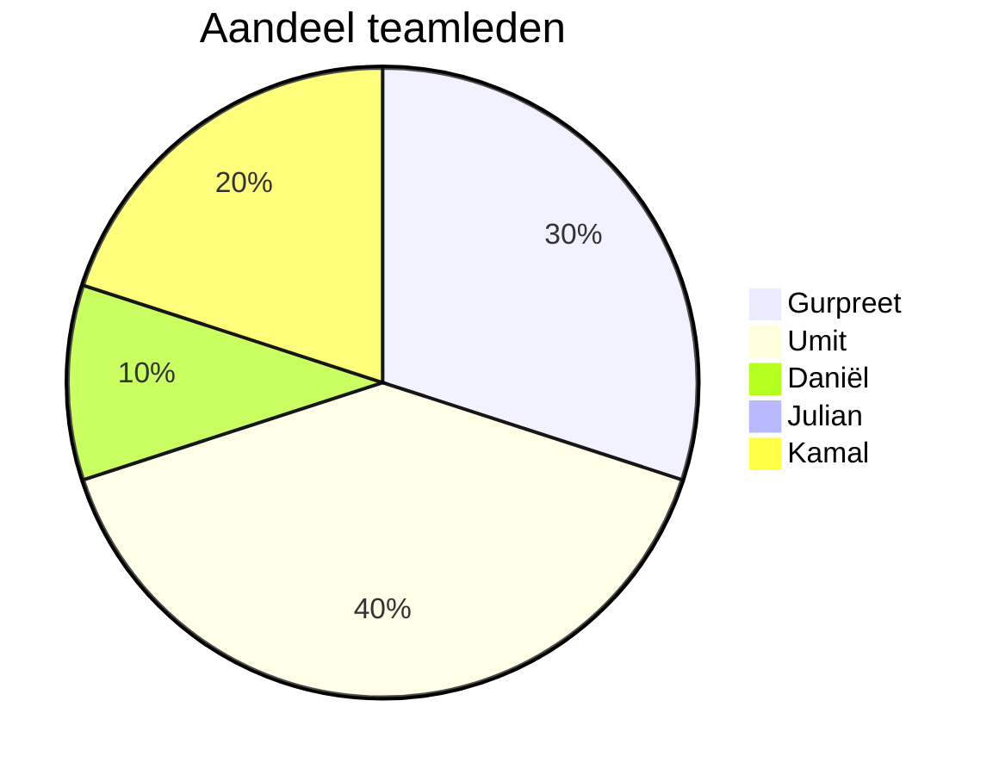

# Retrospective sprint 0

## Uitkomst retrospective

### Things you liked:
**Gurpreet:** Ik vond het super leuk om het verhaal te bedenken! We creëerden een spannende wereld in het New York van 1932 met Detective McCarthy en zijn assistent John. Het schrijven van de intro gaf me een creatief gevoel en het gaf ons project een coole context. Het bedenken van personages en het verhaal was echt tof. Ik kijk uit naar meer van dit soort creatieve dingen! 

**Umit:**
1. Ik vond het leuk hoe wij met zijn allen samen aan verschillende ideeën zijn gekomen richting de concept en structuur van onze game. 
2. Het idee van een game developen nadat wij eerst verschillende websites eerst hebben gebouwd was een leuk idee en uitdaging om te bedenken.  

**Daniël:**

1. Veel creativiteit/ideeën voor de backstory van de game. 
2. Iedereen die aan een kamer heeft gewerkt heeft goede ideeën gehad qua puzzels/objecten. 
3. We helpen elkaar met programmeer uitdagingen. 
4. Goede Git structuur voor ons project. 

### Things to change:
**Gurpreet:** Ik vond dat we niet goed samenwerkten en communiceerden tijdens de eerste sprint. Het leek alsof we niet goed begrepen wat we moesten doen. Laten we erover praten en proberen het te verbeteren. Ik denk dat als we beter communiceren en meer samenwerken, we succesvoller zullen zijn in de volgende sprints. 

**Umit:**
1. Communiceren kon veel beter, dingen worden besproken maar soms veranderd zonder een sign en de structuur veranderd steeds met de dag.
2. Opstellen van onze presentatie moeten wij voortaan beter oppakken, het werd uiteindelijk te chaotisch en rommelig om een iets professioneel te kunnen voorbrengen.

**Daniël**
1. Presenaties beter voorbereiden. De product review ging wat chaotisch. 
2. Communicatie. Het is niet altijd duidelijk wie waar mee bezig is. 

## Verbeterpunten voor de volgende sprint

1. We gaan presentaties beter voorbereiden. Van te voren samenzitten en doorbespreken wie wat moet gaan zeggen. Ook een powerpoint samen maken.  
2. We gaan komende sprint beter communiceren. Tijdens fysieke aanwezigheid op school beginnen we met een daily standup om voortgang te bespreken en af te spreken wie waar mee bezig gaat. 

## Aandeel teamleden

Umit scoort 40%, want hij heeft veel van de storyline bedacht. Ook heeft bijv. hij het samenwerkingscontract grotendeels opgesteld. Nam ook veel initiatief. 

Gurpreet scoort 30%, want hij had de basis document die Umut had gemaaakt aangepast met de benodige informatie voor de product review en de figma gemaakt met Kamal.  

Kamal scoort 20%, want hij heeft grotendeels de figma prototype opgesteld voor de presentatie, en kwam met wat paar ideeën voor de functies binnen de game. 

Daniël scoort 10%, hij heeft zijn het werk voor zijn kamer gedaan maar door zijn afwezigheid ivm ziekte daarbuiten weinig input gehad aan de andere zaken als productreview e.d. 

Julian scoort 0% gezien zijn afwezigheid tijdens deze sprint. 

## Feedback n.a.v. sprint 0

### Positief feedback
#### Gurpreet
**Van Umit**: Je nam veel initiatief, ging zelf altijd achter aan de project en wou wel netjes op planning zitten inplaats van achterlopen.  
**van Daniel**: Je nam veel initiatief. Je hebt een goede werkhouding.  

#### Umit:
**Van Gurpreet**: Ik zie dat jij heel creatief was tijdens het bedenken van de storyline wat niet echt makkelijk zou zijn voor mij.  
**Van Daniel**: Ook jij nam veel initiatief. Je had veel input voor de storyline waar ik dat zelf niet had.  

#### Daniel:
**Van Gurpreet**: Ik zie wel dat jij veel wilt leren en probeert te begrijpen wat ik goed vind dat is hoe steeds meer leert  
**Van Umit**: Je wilt je best doen en een bijdrage aan de project leveren ondanks de feit dat je bent omsingeld door nieuwe klasgenoten, en dat is wel een leuk punt.  

### Constructief feedback
#### Gurpreet
**Van Umit**: Soms pastte je teveel dingen aan wat betreft de documentatie wat vaker niet helder  voor mij werd en voor mijn gevoel juist tegen de punt van de documentatie in ging. met als voorbeeld de storyline en  
**Van Daniel**: Ivm mijn afwezigheid heb ik te weinig samengewerkt en geen feedback op dit gebied.  

#### Umit:
**Van Gurpreet**: Dat je soms te laat bent waardoor je belangerijken punten mist die aangepast zijn bijvoorbeeld.  
**Van Daniel**: Ivm mijn afwezigheid heb ik te weinig samengewerkt en geen feedback op dit gebied.  

#### Daniel:
**Van Gurpreet**: Wat ik heb gemerkt is dat wanneer wij praten met elkaar dan heb ik het gevoelt dat jij iets wilt zeggen en dat niet doet.  
**Van Umit**: Het komt wel vaker sterk over alsof je terughoudend bent met je eigen input en mening, net alsof het lijkt alsof je gelooft dat je stem niet zo even veel meetelt als de rest.  

