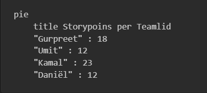

# Retrospective sprint 1

## Verbeterpunten vorige sprint

**Gurpreet:**
> 1. Ik vond dat we niet goed samenwerkten en communiceerden tijdens de eerste sprint. Het leek alsof we niet goed begrepen wat we moesten doen. Laten we erover praten en proberen het te verbeteren. 
> 2. Als we beter communiceren en meer samenwerken, we succesvoller zullen zijn in de volgende sprints. 

**Umit:**
> 1. Communiceren kon veel beter, dingen worden besproken maar soms veranderd zonder een sign en de structuur veranderd steeds met de dag.
> 2. Opstellen van onze presentatie moeten wij voortaan beter oppakken, het werd uiteindelijk te chaotisch en rommelig om een iets professioneel te kunnen voorbrengen. 

**Daniël**
> 1. Presenaties beter voorbereiden. De product review ging wat chaotisch. 
> 2. Communicatie. Het is niet altijd duidelijk wie waar mee bezig is. 

**Kamal:**
> 1. Heeft retro sprint 0 gemist. 

**Julian:**
> 1. Is nooit aanwezig. 

### Acties ondernomen in de afgelopen sprint:

**Verbeterde communicatie:** We hebben ons gericht op het verbeteren van onze communicatie door regelmatige updates te geven over ons werk en beslissingen te nemen in overleg met het hele team. Dit heeft geleid tot een beter begrip van elkaars taken en verantwoordelijkheden. 

**Voorbereiding van presentaties:** We hebben meer tijd besteed aan het voorbereiden van onze presentaties. Dit omvatte het plannen van de structuur van de presentatie, het verdelen van taken en het oefenen van de presentatie voorafgaand aan de daadwerkelijke presentatie. Hierdoor verliep de productreview gestructureerder en professioneler. Maar dit kan nog beter. 

> 1. Opstellen van een gedetailleerd plan voor elke presentatie, inclusief specifieke taken voor elk teamlid en duidelijke deadlines voor de uitvoering ervan. 
> 2. Verwachtingen vaststellen met betrekking tot aanwezigheid bij teamvergaderingen en activiteiten, en individuele doelen stellen om de aanwezigheid te verbeteren, zoals het bijwonen van een minimum aantal daily-standups per sprint. 
> 3. Instellen van concrete deadlines voor het maken van afspraken en het voltooien van taken binnen het team, met duidelijke consequenties voor het niet naleven ervan, om de teamproductiviteit en samenwerking te bevorderen. Dit is zo gedaan omdat de afwezigheid van onze teamgenoten een groot effect heeft gehad met de sprintplanningen en structuur. 

## Fases van Tuckman

#### Vormingsfase
Gedurende de afgelopen 6 weken hebben we als team verschillende fasen van Tuckman's groepsontwikkelingsmodel doorlopen. In de eerste weken, bij aanvang van ons project, bevonden we ons in de *"vormingsfase"*. Tijdens deze fase waren de teamleden vooral bezig met kennismaken, het vaststellen van onze doelen en het verkennen van de verwachtingen. Er was een gevoel van enthousiasme en nieuwsgierigheid binnen het team.   

#### Stormfase
Naarmate we verder kwamen in het project, merkten we dat we de *"stormfase"* betraden. Hierin ontstonden er wat spanningen en onenigheden binnen het team. Verschillende ideeën en werkwijzen botsten soms, wat leidde tot discussies en conflicten. Het was een uitdagende periode waarin we moesten leren omgaan met verschillende perspectieven en werkwijzen.   

#### Normeringsfase
Gelukkig slaagden we erin om deze moeilijke periode te overwinnen en begonnen we langzaam de *"normeringsfase"* te betreden. Tijdens deze fase begonnen we meer begrip te tonen voor elkaars standpunten en werkwijzen. Er ontstond een gevoel van samenwerking en solidariteit binnen het team. We stelden gezamenlijke normen en waarden vast, en er ontstond meer structuur in ons werkproces.   

## Aandeel Storypoints teamleden

Op basis van een schaal van 1/10. 
### Toelichting Storypoints

Actie punten: De reden dat er bij een deel van de team een groot verschil zit tussen de actie punten is omdat sommige leden meer user stories hebben gemaakt dan de andere en de feit dat sommige van die user stories meer complexe code vereisen dan de andere.   

### Aanpak Storypoints
De manier dat wij het beste de verschil van de taken eerlijk kunnen verdelen over elkaar is om een stapje terug te nemen en kijken waarom dat zo lijkt. In sommige gevallen kan het zijn dat een lid te snel is gaan doorwerken en meteen al bij veel complexere taken is gekomen dan de anderen, ook is het zo dat wij onze user stories goed moeten prioriteren op basis van wat verwacht wordt en wat niet. Dit helpt het team om zich te concentreren op de meest belangrijke en haalbare taken, wat kan leiden tot een efficiëntere verdeling van de storypoints.

Conclusie: Wij moeten onze sprint planning de volgende keer veel beter evalueren voordat wij aan de bak gaan.

## Feedback voor teamleden

### Feedback Gurpreet

#### Tops

> 1. Je hebt veel iniatief getoond en je werkt heel hard voor de project. 
> 2. Hij helpt graag. 

#### Tips

> 1. Het is beter dat Gurpreet dat zich beter moet relaxen bij bepaalde situaties binnen de sprint. 
> 2. Bij presenteren is het beter als hij steady blijft omdat hij vaak de neiging heeft te snel door alles heen te gaan uit nerveusheid. 

### Feedback Umit

#### Tops

> 1. Je bent erg creatief en goed in het bedenken van de storylines. 
> 2. Je bent goed in het leiding nemen en neemt een proactieve houding. 

#### Tips

> 1. Meer focus zetten op je eigen werk tijdens les en minder afgeleid raken. 
> 2. Meer hulp vragen wanneer je vast zit. 

### Feedback Kamal

#### Tops
> 1. Hij is heel gedreven en proactief, en wilt alles snel afhebben. 
> 2. Vraagt wel aan teamleden of ze hulp nodig hebben van zichzelf. 

#### Tips

> 1. Deze tip koppelt aan de eerste top, omdat Kamal zo gedreven is doet hij soms veelsteveel wat nodig is wat dingen extra lastiger kan maken in de toekomst. 
> 2. Beter op tijd melden als hij afwezig is. 

### Feedback Daniël

#### Tops
> 1. Er is initiatief en het is duidelijk dat hij zijn bijdrage wilt leveren aan de groep. 
> 2. Komt met leuke ideeën. 

#### Tips
> 1. Daniel is nog steeds redelijk afstandelijk en meer op zichzelf tijdens de sprint. Dit maakt het vager voor iedereen om te inschatten wanneer hij open is om benaderd te worden. 
> 2. Meer je werk comitten zodat het makkelijker maakt voor de team om iedereen's progressie bij te houden. 