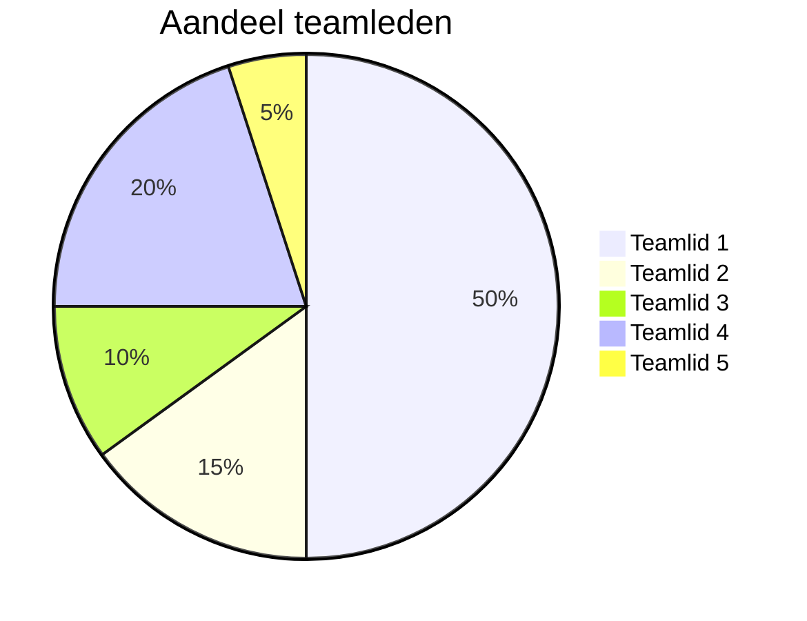

# Retrospective sprint 0

// Alle tekst met // weghalen voordat je pushed naar Gitlab a.u.b. Zorg dat het markdown document er verzorgd uitziet.

// De retrospective doe je met je team.

// Na de gezamenlijke retrospective schrijf je per persoon een reflectie op je eigen functionereen in sprint 0 en de feedback die je hebt gekregen van je teamleden.

// Vervolgens maak je een retrospective-formulier in Scorion, waarin je voor alle drie de gedragscriteria onderbouwd hoe je deze sprint gefunctioneerd hebt. Je verwijst naar het retrospective document van het team en je persoonlijke reflectie op sprint 0.

## Uitkomst retrospective

### Things you liked:

**Gurpreet:** Ik vond het super leuk om het verhaal te bedenken! We creëerden een spannende wereld in het New York van 1932 met Detective McCarthy en zijn assistent John. Het schrijven van de intro gaf me een creatief gevoel en het gaf ons project een coole context. Het bedenken van personages en het verhaal was echt tof. Ik kijk uit naar meer van dit soort creatieve dingen!

### Things to change:
**Gurpreet:** Ik vond dat we niet goed samenwerkten en communiceerden tijdens de eerste sprint. Het leek alsof we niet goed begrepen wat we moesten doen. Laten we erover praten en proberen het te verbeteren. Ik denk dat als we beter communiceren en meer samenwerken, we succesvoller zullen zijn in de volgende sprints.

## Verbeterpunten voor de volgende sprint

// Maak een lijstje van 2 - 5 zaken die jullie in de volgende sprint willen verbeteren. Formuleer deze zo concreet mogelijk.

## Aandeel teamleden

// geef per teamlid aan wat zijn of haar aandeel was in de opgeleverde producten van deze sprint. Vervang hieronder de namen van de teamleden en geef per teamlid het percentage. De mermaid code genereert vervolgens een pie-chart. Geef onder de pie chart een korte toelichting.

## Feedback n.a.v. sprint 3

// Geef hieronder zo specifiek mogelijke feedback voor elk teamlid.

// tip: bereid de feedback op je teamleden eerst individueel voor en ga dan pas samen zitten.

// herhaal onderstaande kopjes voor elk teamlid.

### Feedback teamlid

#### Tops

// gezamenlijk zorg je per teamlid voor 2-3 complimenten.

### Tips

// gezamenlijk zorg je per teamlid voor 2-3 tips.
