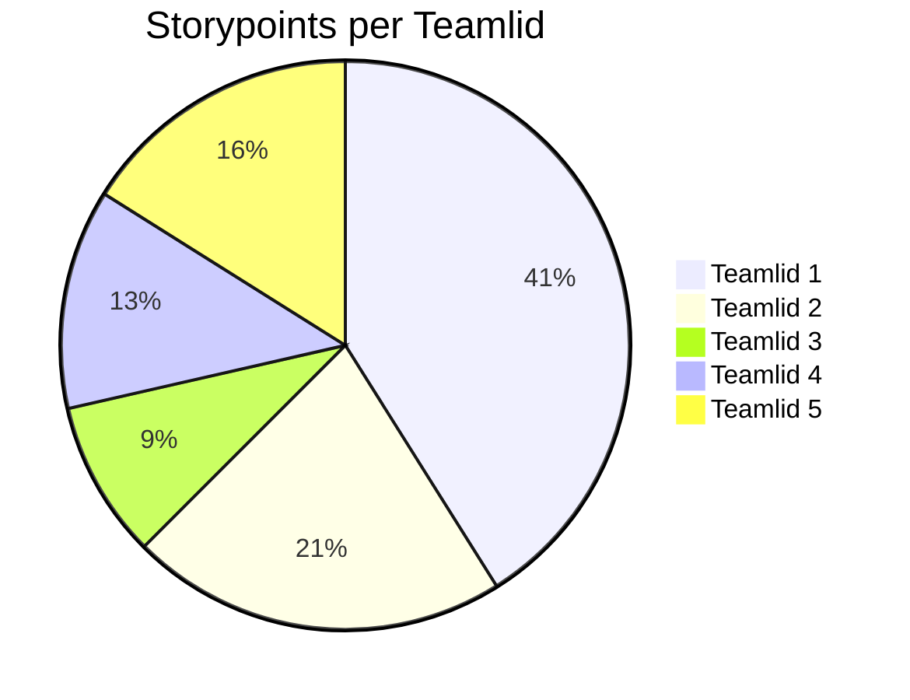

# Retrospective sprint 1

## Verbeterpunten vorige sprint

// Herhaal hier de verbeterpunten die jullie vorige retrospective hebben opgesteld en beschrijf per punt wat jullie hiermee afgelopen sprint hebben gedaan. Is het opgepakt? Hoe? Heeft het effect gehad?

## Uitkomst retrospective

// Gebruik één van de restrospectives uit de Spotify retro-kit (<https://storage.googleapis.com/>production-eng/1/2017/12/retro-kit3.pdf) en plaats de uitkomsten hier.

## Verbeterpunten voor de volgende sprint

// Maak een lijstje van 2 - 5 zaken die jullie in de volgende sprint willen verbeteren. Formuleer deze zo concreet mogelijk.

## Teamontwikkeling

// Beschrijf jullie teamontwikkeling over de afgelopen 6 weken aan de hand van de fases van Tuckman. Welke fases hebben jullie doorlopen? Waaraan was dat herkenbaar? In welke fase zitten jullie nu? Waar zie je dat aan?

## Aandeel teamleden

// geef per teamlid aan hoeveel storypoints hij/zij deze sprint heeft kunnen realiseren. Vervang hieronder de namen van de teamleden en geef per teamlid het aantal storypoints. De mermaid code genereert vervolgens een pie-chart. Geef onder de pie chart een korte toelichting: wat valt op?  Kunnen jullie de verschillen verklaren?

## Feedback voor teamleden

// Geef hieronder zo specifiek mogelijke feedback voor elk teamlid.

// tip: bereid de feedback op je teamleden eerst individueel voor en ga dan pas samen zitten.

// herhaal onderstaande kopjes voor elk teamlid.

### Feedback teamlid

#### Tops

// gezamenlijk zorg je per teamlid voor minimaal 2 complimenten.

### Tips

// gezamenlijk zorg je per teamlid voor minimaal 2 tips.
