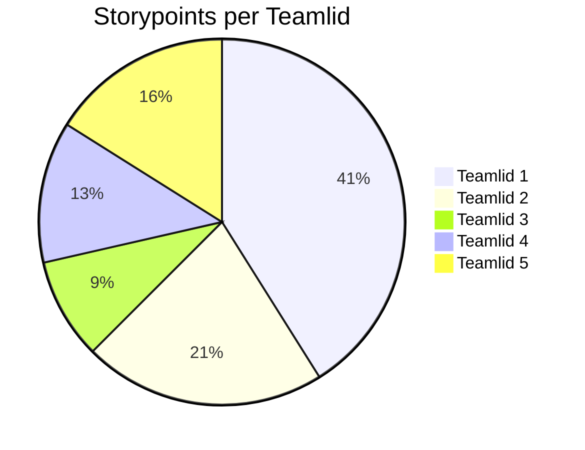

# Retrospective sprint 2

// voor herkansers: sprint 3

// Alle tekst met // weghalen voordat je pushed naar Gitlab a.u.b. Zorg dat het markdown document er verzorgd uitziet.

// De retrospective doe je met je team.

## Verbeterpunten vorige sprint

// Herhaal hier de verbeterpunten die jullie vorige retrospective hebben opgesteld en beschrijf per punt wat jullie hiermee afgelopen sprint hebben gedaan. Is het opgepakt? Hoe? Heeft het effect gehad?

## Uitkomst retrospective

// Gebruik één van de restrospectives uit de Spotify retro-kit (<https://storage.googleapis.com/>production-eng/1/2017/12/retro-kit3.pdf) en plaats de uitkomsten hier.

## Tips voor blok 4

// Noem 2 - 5 tips op het gebied van samenwerken en Scrum die jullie mee willen nemen naar blok 4.

## Belbinrollen

// Maak een sterkte-zwakte-analyse voor het team, op basis van de teamrollen van Belbin. Stel vragen als:
// Welke rollen missen we? Wat hebben we daarvan gemerkt in het team?
// Welke rollen hebben we (te) veel? Wat hebben we daarvan gemerkt in het team?
// Waarin zijn we sterk? Hoe komt dat?

## Aandeel teamleden

// geef per teamlid aan hoeveel storypoints hij/zij deze sprint heeft kunnen realiseren. Vervang hieronder de namen van de teamleden en geef per teamlid het aantal storypoints. De mermaid code genereert vervolgens een pie-chart. 

// Geef onder de pie chart een korte toelichting: wat valt op?  Kunnen jullie de verschillen verklaren?

## Feedback voor teamleden

// Geef hieronder zo specifiek mogelijke feedback voor elk teamlid.

// tip: bereid de feedback op je teamleden eerst individueel voor en ga dan pas samen zitten.

// herhaal onderstaande kopjes voor elk teamlid.

### Feedback teamlid

#### Tops

// gezamenlijk zorg je per teamlid voor minimaal 2 complimenten.

### Tips

// gezamenlijk zorg je per teamlid voor minimaal 2 tips.
