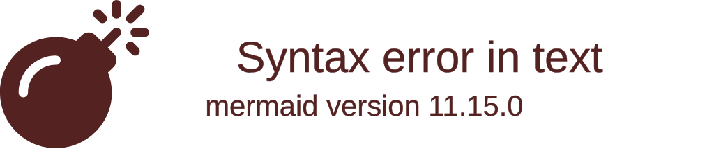

# Retrospective sprint 2

## Verbeterpunten vorige sprint

1. We gaan presentaties beter voorbereiden. Van te voren samenzitten en doorbespreken wie wat moet gaan zeggen. Ook een powerpoint samen maken.  
2. We gaan komende sprint beter communiceren. Tijdens fysieke aanwezigheid op school beginnen we met een daily standup om voortgang te bespreken en af te spreken wie waar mee bezig gaat.  

### Aanpak
In tegenstelling tot de vorige twee sprinten hebben wij als team onze samenwerking serieus genomen richting onze project, wij hebben betere stappen genomen richting het voorbereiden van onze eindproduct en zijn veel meer online proactief geweest qua communicatie en werklevering. Dit hebben wij kunnen doen ondanks wij begonnen als een vijftal maar eindigden als een drietal. 

## Uitkomst retrospective
### Things you liked:
**Gurpreet:** 
Ik ben echt blij met hoe goed we samenwerken deze tijd. Het is geweldig omdat we goed met elkaar praten en iedereen begrijpt elkaar. Met Umit en Kamal hebben we een spel gemaakt dat echt goed werkt! Dat is echt gaaf! Ik kan niet wachten om nog meer samen te werken en nog meer leuke dingen te maken. 

**Umit:**
Ik was heel tevreden met onze teamwork tijdens sprint 2. Bij de vorige sprinten was het niet per se slecht maar iedereen had niet zijn prioriteiten vast inclusief ik, dat zorgde ervoor dat wij allemaal niet richting het zelfde eindpunt gingen werken. Toch hebben wij na reflectie dit gelijk opgepakt en zijn wij allemaal dedicated richting de product gaan werken. Ondanks dat wij met twee man minder zijn ge-eindigt ben ik blij met de game dat wij hebben kunnen ontwikkelen. 

**Kamal:**
Veel creativiteit/ideeën voor de backstory van de game. Iedereen die aan een kamer heeft gewerkt heeft goede ideeën gehad qua puzzels/objecten. We helpen elkaar met programmeeruitdagingen. 

## Tips voor blok 4

> 1. Gurpreets tip was dat wij beter direct kunnen overleggen over onze einddoel inplaats van het afwachten.  
> 2. Kamal zijn tip was dat wij beter doelen kunnen noteren wat betreft afspraken, ect.  
> 3. Misschien is het een beter idee als de team volgende blok op tijd begint met het mergen van alle branches om problemen en tijdsnood te voorkomen. 
> 4. Umit zijn tip is dat de groep beter hun presentaties moet formuleren in de volgende blok om het niet zo rommelig te maken tijdens de presentatie zelf.  
> 5. Dat wij sneller aan de bel trekken als er een probleem is zodat wij als team dat gezamelijk kunnen oplossen en snel verder te werk kunnen gaan.  

## Belbinrollen

### Welke rollen?

**Gurpreet** 
1. De Zorgdrager 
2. De Groepswerker 
3. De Monitor 

**Umit**
> 1. De Plant 
> 2. De Voorzitter 
> 3. De Monitor 

**Kamal**
> 1. De Bedrijfsman 
> 2. De Monitor 
> 3. De Vormer 

### Welke missen wij?

Wij missen de volgende rollen in onze team: 
1. De Brononderzoeker 
2. De Specialist 

#### Sterktes:

1. De Zorgdrager (Gurpreet): Gurpreet heeft de rol van de Zorgdrager, wat betekent dat hij veel aandacht besteedt aan details, kwaliteit, en veiligheid. Dit draagt bij aan de algehele kwaliteit en zorgvuldigheid van het teamwerk. 

2. De Monitor (Gurpreet, Umit, Kamal): Het team heeft meerdere Monitors, wat betekent dat er aandacht is voor analyse, kritisch denken en zorgvuldige besluitvorming. Dit helpt bij het vermijden van fouten en het waarborgen van de juistheid van beslissingen. 

3. De Plant (Umit): Umit heeft de rol van de plant, wat betekent dat hij veel creativiteit en visie heeft wat meegenomen wordt richting het development van onze project. 

#### Zwaktes:

1. De Vormer: Er lijkt een gebrek te zijn aan een gedreven en gepassioneerde persoonlijkheid die uitdagingen aangaat en anderen motiveert. Dit kan leiden tot een gebrek aan proactieve aanpak binnen het team. 
2. De Specialist: Er is geen specifieke persoon die diepgaande kennis heeft op een bepaald gebied. Dit kan een belemmering zijn bij het aanpakken van complexe problemen die specialistische kennis vereisen. 
3. De Plant: Planten zijn typisch te veel bezig met hun ideeën en visie, wat naar slechte communicatie skills leid, wat gelukkig niet echt aanwezig was bij Umit. 

#### Teveel van een rol: 

1. De Monitor: Met drie Monitors in het team bestaat het risico op overanalyse en besluiteloosheid. Te veel focus op analyse kan leiden tot vertragingen in het besluitvormingsproces en het verlies van kansen. 

#### Ontbrekende rollen: 

Aanvullen van ontbrekende rollen: Het team zou kunnen overwegen om individuen aan te trekken of te ontwikkelen die de ontbrekende rollen kunnen vervullen, zoals een Vormer die het team motiveert en een Specialist die diepgaande kennis biedt op een specifiek gebied. 

Balanceren van rollen: Hoewel het hebben van Monitors waardevol is, is het belangrijk om ervoor te zorgen dat deze rol niet domineert. Het kan helpen om de verantwoordelijkheden binnen het team op een evenwichtige manier te verdelen, zodat er ruimte is voor zowel analyse als actiegerichtheid. 

Teamontwikkeling: Het team zou kunnen investeren in trainingen en workshops gericht op het verbeteren van teamdynamiek, communicatie en het omgaan met conflicten. Dit kan helpen om de zwakke punten aan te pakken en de algehele effectiviteit van het team te vergroten. 

## Aandeel teamleden

Wij hebben besloten als groep dat onze bijdrage wel heel erg gelijk was. Wat ons op viel was dat iedereen hun bijdrage in hun eige manier had kunnen opleveren, sommige waren bezig met styling, de andere meer richting de eind functies en de andere deed weer juist de extra toevoegingen. Waar wij heel blij mee waren was dat de manier van werking in onze product zo efficiënt was dat iedereen makkelijk kon volgen wat de andere deed en hun manier van uitvoeren. 

Dat maakte alles veel makkelijk voor de andere om elkaars tools te kunnen gebruiken binnen hun kamers bijvoorbeeld. 

Een reflectie van onze samenwerking in een meer constructieve wijze was dat wij veel te laat onze werk drive als team hadden gekregen, al hoewel de reden kon zijn dat wij twee man waren uiteindelijk, zijn wij alsnog ontevreden over de eind product wat wij hebben kunnen leveren. Hopelijk met iets meer tijd hadden wij kunnen perfecten. 

## Feedback voor teamleden

### Feedback Gurpreet

#### Tops
> 1. Gurpreet heeft zijn presentatie skills sterk verbetered met vorige keer. 
> 2. Gurpreet heeft een uitstekende bijdrage geleverd als de Zorgdrager. hij bleef mensen vragen of ze hulp nodig hadden. 

#### Tips
> 1. Gurpreet heeft wel nog steeds te veel last van nerveusheid in het algemeen rondom bijvoorbeeld de products ect. Dit is sterk verminderd met vorige sprinten maar is nog steeds aanwezig, meer een punt om hierop beter te letten zodat hij kan improven. 

### Feedback Umit

#### Tops
> 1. Umit heeft in de laatste sprint hard gewerkt, en kon de meeste taken afronden binnen de groep. 
> 2. Umit is een hele creative persoon waardoor we deze text-based game hebben kunnen maken. Hij heeft er heel goed over nagedacht, alleen wat er in het werkelijkheid is uitgekomen was niet echt wat hij wou want we met 3 mensen waren overgebleven. 

#### Tips
> 1. Beter optijd beginnen met je taken zodat je niet op een keer druk zet op je zelf, dus maak een planning van je taken 

### Feedback Kamal

#### Tops
> 1. Kamal zijn samenwerking was sterk verbeterd tijdens sprint 2 in vergelijking met de vorige sprinten. 
> 2. Kamal heeft iedereen in de groep ondersteund tijdens problemen 

#### Tips
> 1. Neem je verantwoordlijkheid voor je taken 
> 2. Bespreek wat je wilt aanpassen met je team zodat iedereen weet wat je wilt en of anderen ook het willen 